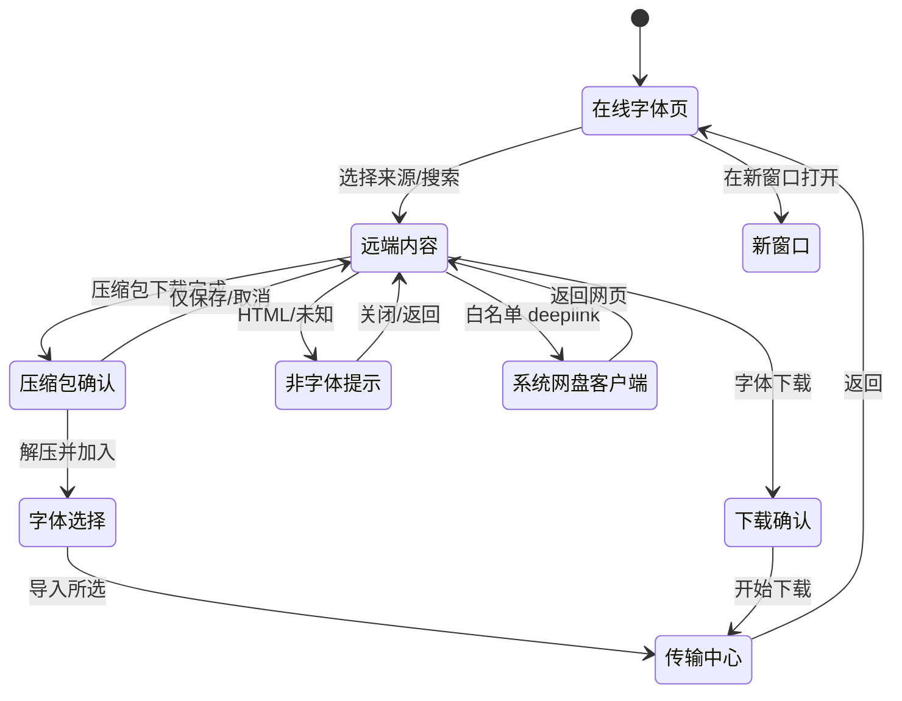
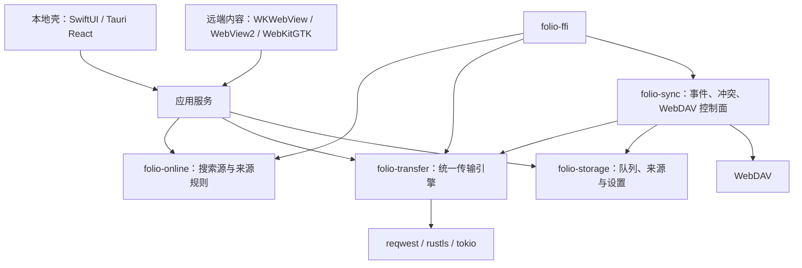

# 在线字体浏览器与统一传输引擎规划

规划日期：2026-10-20。状态：**设计，待实施**。本文不表示相关源码已经实现，
也不改变当前 Roadmap 的 P0–P9 资源顺序。

适用范围：macOS、Windows、Linux 桌面端。移动端继续沿用现有 RN/Expo 与原生
模块，不在本轮改造范围。

相关文档：

- [产品工作流架构](product-workflows.md)：Import、Collect、Reference、Export 的语义。
- [同步架构](sync-architecture.md)：单 WebDAV、多端点、LAN 与 wire 版本边界。
- [路线图](../FOLIO_ROADMAP.md)：F4 当前状态与优先级。
- [赞助计划](sponsor-release-plan.md)：官方构建与自行编译的能力边界。

本文取代旧 F4 中“继续扩展 Google Fonts 目录”的方向。旧实现中已经收集的字体
仍然属于普通字体库内容，不因在线来源改版而删除或改变归属。

## 1. 结论摘要

1. **停止目录式在线字体拉取。** 移除内置 Google Fonts 目录、镜像模板和目录内
   直接下载界面；不再把某个字体站的目录复制进客户端。
2. **改为系统 WebView 承载的标签式字体浏览器。** macOS 使用 WKWebView，Windows
   使用 WebView2，Linux 使用 WebKitGTK。每个窗口固定一个**本地壳 WebView**（自定义
   标题栏、来源 tab、搜索框、浏览器控制）和一个**远端内容 WebView**（当前来源
   网页）；tab 只切换同一个内容 WebView，不按 tab 创建多个 WebView。允许新窗口，
   每个新窗口同样是一壳一内容。禁止 iframe、HTML 内嵌 HTML 和外站反向代理，
   也不把 Tauri 的不稳定多 WebView 作为生产依赖。
3. **在线字体页是来源 tab + 网页内容，不是爬虫。** 顶部 tab 展示所有已启用来源，
   下方直接显示当前来源网页；共享搜索框把关键词发送到该站搜索页。默认内置只包含
   已知可免费下载的站点，用户可以手动新增、编辑、排序和停用来源，并接受来源与
   网盘免责声明。Folio 不抓取、不解析站点搜索结果。
4. **下载由 WebView 拦截，交给统一传输引擎。** 点击网页下载时，先判断响应是否
   为字体或压缩包。字体直接询问“加入字体库”或“保存到…”；压缩包正常下载，完成
   后询问是否解压并加入字体库，用户确认后再选择具体字体；HTML、错误页等非字体
   内容才提示并复制链接，不直接打开或跳转。
5. **字体下载与云同步共用一个多线程传输引擎。** 使用仓库已有的
   `reqwest`/`rustls`/`tokio` 与 SQLite，新增 `folio-transfer` 统一排队、分段、
   断点、重试、校验和进度；不内置 aria2。WebDAV 的控制面仍由 `folio-sync`
   负责，文件数据面走统一引擎。
6. **用户脚本默认关闭。** 提供标准用户脚本元数据的最小兼容运行时。Tampermonkey
   （篡改猴）不随 Folio 捆绑；只有用户明确同意后，才从官方站点或 Chrome/Edge/
   Firefox 商店安装。系统 WebView 不能加载扩展时，可选下载一个**独立的小型
   浏览器**（CEF/Chromium 内核），同样不预先捆绑；首次进入在线字体页时询问用户
   是否下载并启用。运行期下载不等于许可证免责，商店条款和扩展自身许可仍需遵守。
7. **浏览器数据不同步。** Cookie、历史、搜索源、下载地址和站点登录状态仅留在
   本机，不进入字体库同步事件，也不上传到 WebDAV。
8. **常见网盘 deeplink 直通系统。** 百度网盘、阿里云盘、夸克、115、天翼、
   123 云盘、蓝奏云等白名单 scheme 不在 Folio 内弹确认、不改写 URL、不延迟，
   原样交给系统客户端；未知 scheme 仍拒绝。
9. **来源与许可必须可见。** 下载字体时记录来源站点、页面地址、下载时间、格式
   与用户可见的许可提示；Folio 不替用户判断商用授权，也不把“可免费下载”写成
   “可免费商用”。
10. **网盘跳转保留字体站来源。** 从猫啃网、Google Fonts 等字体站跳到网盘时，
   下载记录和导入来源显示“来源：字体站页面”，网盘只作为“下载经由”显示；不能
   把 `pan.baidu.com`、`pan.quark.cn` 等网盘 URL 冒充字体来源。直接打开网盘时
   明确标记“直接打开网盘”，不伪造字体站归属。

## 2. 现状与问题

### 2.1 现有实现

| 位置 | 当前事实 | 问题 |
| --- | --- | --- |
| `crates/folio-online` | 内置 `google-fonts.json`，提供 Google Fonts 目录查询、预览缓存、镜像模板和 SHA-1 完整性校验 | 只能看到单一来源；更新依赖应用发版；无法覆盖猫啃网、100font、网盘等真实下载路径 |
| `apps/macos/Folio/Views/OnlineFontsView.swift` | SwiftUI 在线字体页、分类/字重筛选、预览与批量收集 | 与目录绑定；没有网页登录、网盘、重定向和非字体下载处理 |
| `apps/macos/Folio/Data/FontOperations.swift` | `OnlineFontOrigin` 记录 provider、family、style、commit、license、source URL | 字段面向 Google Fonts，需要迁移为通用来源快照 |
| `apps/desktop-ui` | Tauri 端没有在线字体页面 | 跨平台范围缺失 |
| `crates/folio-sync` | 已有 WebDAV 事件、对象、上传下载、取消、重试和云端占位 | 下载器与在线字体下载各有一套逻辑，进度、重试和临时文件语义不统一 |
| `crates/folio-storage` | schema v11，已有同步传输状态与字体来源记录 | 没有面向网页下载的持久队列与来源表 |

### 2.2 为什么不能继续做目录拉取

- 字体站点的可下载内容、许可说明和下载入口变化频繁，内置目录很快过期。
- 很多字体只能通过网页登录、验证码、跳转网盘或网盘客户端获得，目录接口无法
  覆盖这些真实流程。
- 目录抓取容易越过站点条款，也会把“页面可访问”误当成“允许批量复制”。
- 用户需要的是在来源站点上完成选择、登录和下载，而不是另一个不完整镜像。

### 2.3 保留的边界

- `folio-core` 继续只做字体解析、身份、修订和健康诊断，不引入网络或 WebView。
- 既有字体库、收藏、来源和同步数据不因在线入口改版而删除。
- 现有 `folio-sync` 的 wire v1、事件合并和冲突语义不因下载器重构而改变。
- 已收集字体继续按 `FontIdentityId`、`FontRevisionId` 和真实文件记录工作，
  不会因为来源页失效而失去文件。

## 3. 关键决策

### 3.1 浏览器承载：本地壳 + 单远端内容，禁止 iframe

**修订说明：** 在线字体页要求上方来源 tab、下方网页内容；Tauri 端还要求保留本地
页面和自定义标题栏。上一版“单窗口单 WebView”无法同时满足这些要求：不使用 iframe
时，本地 tab/标题栏与远端页面必须由两个渲染面承载。本版改为**每个窗口固定两个
渲染面**：

- **本地壳 WebView：**自定义标题栏、来源 tab、搜索框、浏览器控制、下载确认、
  非字体提示、免责声明、传输中心和设置等本地页面。
- **远端内容 WebView：**只显示当前来源网页。

不按 tab 创建 N 个 WebView。tab 是来源切换器，同一窗口只有一个内容 WebView；
切换 tab 只改变这个 WebView 的 URL。

```text
┌─ 自定义标题栏 / 来源 tab ─────────────────────────────┐
│ [Google Fonts] [猫啃网] [100font] [Font Library] [+]  │
│ [ 搜索字体… ] [后退] [前进] [刷新] [地址] [下载]     │
├───────────────────────────────────────────────────────┤
│                                                       │
│              远端内容 WebView（当前来源）              │
│                                                       │
└───────────────────────────────────────────────────────┘
```

本地壳始终占满窗口；远端内容视图定位在工具条下方。显示下载确认、非字体提示、
免责声明或传输中心时，隐藏远端内容视图，让本地壳的页面覆盖内容区；关闭本地
页面后恢复内容视图。这样不需要第三个 WebView 或 iframe。

**每窗口约束：**

- 每窗口最多两个 WebView：一个本地壳、一个远端内容。
- 来源 tab 只切换内容 WebView 的 URL；不保留每个 tab 的独立 WebView，也不在
  后台加载所有来源。
- 允许新窗口。新窗口同样是一个本地壳 + 一个内容 WebView，可打开当前来源或
  当前页面；窗口数可配置上限（建议 4），达到上限时复用现有窗口并提示。
- 站点 `window.open` 默认在当前内容视图打开；需要登录弹窗的站点可配置为新建
  Folio 窗口。不得创建没有本地壳的裸远端窗口。
- 不使用 iframe、HTML 内嵌 HTML、服务端反向代理；不在远端页面注入本地 tab、
  标题栏或浏览器控制。
- 自定义标题栏、tab 和本地页面由本地壳渲染；Tauri 主窗口保留现有
  `decorations: false` + React 自定义标题栏，内容视图定位在标题栏/搜索栏下方；
  新窗口复用同一套壳。远端内容不能读取或修改壳的 DOM。

**Tauri 承载选型：**

| 方案 | 结论 | 原因 |
| --- | --- | --- |
| iframe / HTML 内嵌 HTML | 拒绝 | 外站 CSP/X-Frame-Options、Cookie、登录和下载不可控，且不是真正隔离 |
| Tauri 稳定单 `WebviewWindow` | 不足 | 无法同时显示本地 tab/标题栏和远端内容 |
| Tauri `unstable` 多 WebView / `add_child` | 仅原型 | 可快速验证两渲染面，但存在白屏、布局和 Linux WebKitGTK 问题，不作为生产依赖 |
| 平台原生子 WebView | **采用** | 本地壳用 Tauri 稳定窗口，远端内容用 WebView2/WebKitGTK 子视图，不依赖 unstable |
| CEF / 自带 Chromium | 拒绝 | 违背系统 WebView 目标，体积与更新成本高 |
| 独立内容窗口 | 不采用 | 不能实现“上方 tab、下方内容”的同窗布局 |

**平台实现：**

| 平台 | 本地壳 | 远端内容 | 说明 |
| --- | --- | --- | --- |
| macOS | SwiftUI/AppKit 自定义标题栏与 tab | WKWebView 子视图 | 两渲染面在同一 NSWindow；使用 WKDownload/CookieStore |
| Windows | Tauri `main` WebviewWindow（React 本地页） | WebView2 子控制器 | 以 Tauri 窗口 HWND 为父窗口，内容区定位在工具条下方；使用 CoreWebView2 下载/Cookie/导航事件 |
| Linux | Tauri 主窗口（React 本地页） | WebKitGTK 子 WebView | 放入 GTK 容器并随窗口尺寸更新；使用 WebKitGTK 下载/Cookie/导航信号 |

- 本地壳与远端内容由 Rust 应用服务协调；壳只发送“导航/后退/前进/刷新/打开地址/
  显示本地页面”等命令，不直接操作内容视图 DOM。
- 远端内容不能访问本地壳的 Tauri IPC、UniFFI、文件系统或本地存储。
- 本地壳的 Tauri capability 只覆盖壳和同样结构的浏览器窗口；每个新窗口只获得
  窗口拖动/最小化/最大化/关闭等最小权限。内容视图不使用 Tauri WebView 能力。
- 原生子 WebView 的创建、定位、DPI 缩放、焦点、z-order、关闭顺序和全屏行为
  必须做批次 0 spike。若目标平台无法稳定嵌入，再评估 Tauri `unstable` 多 WebView
  或独立内容窗口，二者都必须另立 ADR；不得回退到 iframe。

**窗口与 tab：**

- 顶部 tab 横向展示所有已启用来源；超出宽度时滚动，`+` 打开添加来源页，管理入口
  在设置中。
- 共享搜索框作用于当前 tab；切换 tab 后用同一关键词重新打开对应站点搜索页。
- 当前 tab 内点击站内链接，内容 WebView 正常导航；tab 标签仍代表来源，标题栏
  显示页面标题。
- “在新窗口打开”复制当前来源/页面到新窗口；每个新窗口仍是本地壳 + 单内容视图。
- 关闭窗口时，内容 WebView 的 Cookie 保留；窗口状态、tab 选择和滚动位置按窗口
  保存在本地，不进入同步。

**Tauri 稳定 API 的适用范围：**

| 能力 | 本地壳 | 远端内容 |
| --- | --- | --- |
| 窗口/自定义标题栏 | Tauri `WebviewWindow`、窗口控制 | 不适用 |
| 本地页面/路由 | Tauri 本地资源 | 不适用 |
| 导航 | 壳内本地路由 | 平台适配（WebView2/WebKitGTK/WKWebView） |
| 下载 | 不适用 | 平台适配的下载事件 |
| Cookie | 壳自身 origin | 内容视图独立 Cookie 存储 |
| 权限 | Tauri capability 只给壳 | 默认拒绝摄像头/麦克风/通知等 |

`WebviewWindowBuilder` 的 `on_download`、`cookies_for_url` 等稳定 API 只作用于
Tauri 管理的壳，不自动作用于原生子内容视图；内容侧必须使用平台事件。若批次 0
改用 Tauri `unstable` 多 WebView，才可复用这些 API，但必须按 unstable 风险单独
验收。

### 3.2 来源 tab：本地壳选择，内容视图加载

**决策：**

在线字体页顶部 tab 展示所有已启用来源；点击 tab 或搜索时，只让**当前窗口的
单个内容 WebView** 加载该来源的站内搜索页。Folio 不在后台抓取、解析或缓存站点
结果，也不为每个 tab 常驻一个 WebView。

- 查询使用 `{{query}}` 占位符，由 URL 构建器做 UTF-8 百分号编码；可选
  `{{language}}` 占位符。
- tab 顺序、启用状态和默认来源来自本地搜索源配置；所有来源在 tab 条中可滚动
  查看，`+` 新增来源。
- 默认搜索源只包含已知可免费下载的站点；不预置付费字体商城、素材站或需要
  付费会员才能下载的来源。
- 自定义来源允许用户添加任意 HTTPS 字体站，但必须明确标记“自定义”，并接受
  来源与网盘免责声明。
- 支持在来源配置中标记“可能需要网盘客户端”；该标记只影响提示文案，不改变
  deeplink 白名单。
- 内置搜索源随应用发版更新，不静默从远端拉取配置；避免配置供应链风险。

**添加方式：**

1. 手动填写名称、主页、搜索 URL、可选图标、备注和“可能需要网盘客户端”。
2. 输入主页后读取 OpenSearch 描述（若站点提供），导入名称与搜索模板。
3. 从 JSON 文件导入/导出搜索源；导入前逐项校验，不执行脚本。

**免责声明：**

首次进入在线字体页、首次添加自定义来源时展示可关闭的声明；自定义来源添加
对话框必须勾选确认后才能保存。网盘 deeplink 本身不做确认或声明弹窗，避免打断
系统拉起客户端的时机：

```text
来源与下载声明
────────────────────────────────────────
在线字体由第三方站点提供，Folio 不托管、不复制、不保证其内容。
字体是否可免费商用、是否需要署名或遵守其他条款，请以来源页面和
字体许可文件为准。

部分来源会跳转第三方网盘或拉起本机网盘客户端。Folio 不控制这些
站点和客户端，也不绕过登录、验证码、会员限制或广告。
```

- 免责声明不是一次性的法律授权，不替用户判断字体许可。
- 来源页、下载确认和传输记录保留“来源”和“许可以页面为准”的提示。
- 用户可以在设置中重新查看声明；关闭声明不删除来源，但下次使用网盘 deeplink
  仍保留白名单约束。

**校验规则：**

- 必须是 `https`，不得包含用户名或密码。
- 搜索模板至少包含一个 `{{query}}`，不得包含 `javascript:`、`data:`、`file:`。
- 主机不得是回环、私有或链路本地地址；不允许用搜索源探测局域网。
- 模板长度、名称长度和图标大小有上限；OpenSearch XML 限制大小并禁用外部实体。
- 保存前在同一 WebView 的浏览模式试打开；失败不回滚已保存配置，但显示“无法打开”
  状态。

### 3.3 统一传输引擎：复用 reqwest/tokio，不内置 aria2

**候选方案比较：**

| 方案 | 多连接/分段 | 断点与重试 | WebDAV 控制面 | 打包与安全 | 许可 | 结论 |
| --- | --- | --- | --- | --- | --- | --- |
| aria2 sidecar + JSON-RPC | 成熟 | 成熟 | 不支持 PROPFIND/MKCOL 等 | 额外进程、本地 RPC、需分平台签名与打包 | GPL-2.0-or-later，分发需履行源码义务 | 不采用 |
| libcurl / `curl` crate | 成熟 | 成熟 | 需自行组合 | C 绑定、交叉编译与 TLS 栈重复 | MIT 类 | 不采用 |
| `reqwest` + `tokio` + 分段调度 | 需实现调度器 | 需实现持久化 | 与现有 WebDAV 客户端一致 | 已在仓库中使用，rustls，无额外进程 | MIT/Apache-2.0 | **采用** |
| 各平台原生下载器 | 平台差异大 | 平台差异大 | 不适用 | macOS/Windows/Linux 各写一套 | 系统组件 | 不采用 |
| 纯单流 `reqwest` 下载 | 无 | 已有部分 | 一致 | 最简单 | 一致 | 不满足大字体/弱网需求 |

**选择理由：**

- 仓库已经使用 `reqwest`、`rustls`、`tokio`、`tempfile`、`blake3` 和 `rusqlite`，
  继续复用这些经过现有同步流程验证的组件，不新增运行时。
- 云同步不只需要 GET/PUT，还需要 WebDAV 的 PROPFIND、MKCOL、MOVE、DELETE 和
  事件读取。aria2 无法承担控制面，最终仍会形成“两套下载器”，与“统一”目标
  相反。
- 网盘直链经常依赖 Cookie、Referer、User-Agent、一次性签名和站点反盗链；
  在进程内请求更容易精确复制这些头，并做字体内容校验、路径净化和取消。
- aria2 作为独立 GPL 程序会带来额外进程、本地 RPC 攻击面、分平台签名、升级和
  源码分发义务；对本项目收益不足。
- 分段调度器只实现 HTTP Range、临时文件和状态机，HTTP/2、TLS、连接池、Cookie
  解析等继续使用成熟库，不重复造底层轮子。

**边界：**

- 未来若确实需要 BitTorrent、Metalink 或超大文件多源镜像，另立 ADR 评估，
  不在一期引入 aria2。
- 移动端不要求复用同一实现；移动端可保留原生 URLSession/OkHttp 后端，但共享
  “任务状态、错误分类、校验和来源”契约。

### 3.4 用户脚本与可选扩展浏览器

**默认行为：**

- 用户脚本默认关闭，设置页明确显示风险；首次启用需要确认。
- 支持导入标准用户脚本（`.user.js`，含 `==UserScript==` 元数据块）：`@name`、
  `@namespace`、`@version`、`@description`、`@match`、`@include`、`@exclude`、
  `@run-at`、`@grant`、`@require`、`@resource`。
- 不承诺完整 Tampermonkey API。第一期只提供可审计的最小 API 子集；未实现的
  `GM_*` 调用返回明确的“不支持”，不静默失败。
- 用户脚本只在**远端内容 WebView**的页面上下文执行，**永远不能获得本地壳的
  Tauri IPC、UniFFI 或文件系统能力**；本地壳的下载确认、免责声明和传输中心
  不执行用户脚本。

**Tampermonkey（篡改猴）的用户驱动安装：**

- Tampermonkey 不随 Folio 捆绑，也不在后台自动下载或安装。
- 只有用户明确同意后，Folio 才打开 Tampermonkey 官方站点或 Chrome/Edge/Firefox
  官方扩展商店页面，由用户完成安装。
- 不使用 Chrome Web Store、Edge Add-ons 或 Firefox AMO 的自动化下载接口；商店
  条款、扩展许可和账号登录由用户自行处理。
- Tampermonkey 新版是专有软件，不能复制进 Folio 安装包、再分发或修改。
- Firefox 的 `.xpi` 不能直接加载到 Chromium/CEF 扩展宿主；选择扩展浏览器时默认
  使用 Chrome/Edge 版本。只使用 Firefox 的用户可继续在外部 Firefox 中安装
  Tampermonkey，但 Folio 不承诺该路径的下载拦截和加入库流程。

**系统 WebView 与扩展浏览器的边界：**

| 平台 | 系统 WebView 扩展能力 | 处理 |
| --- | --- | --- |
| Windows | WebView2 可加载扩展 | 可复用系统 WebView，但仍由用户安装/选择扩展 |
| macOS | WKWebView 不支持 WebExtensions | 不加载扩展；使用最小运行时或可选扩展浏览器 |
| Linux | WebKitGTK 不支持 WebExtensions | 不加载扩展；使用最小运行时或可选扩展浏览器 |

系统 WebView 无法兼容扩展，而用户又明确要 Tampermonkey 时，提供**独立的可选
扩展浏览器**：

- 使用 CEF（Chromium Embedded Framework）作为独立窗口/进程，支持 Chromium
  扩展；CEF 为 BSD，Chromium 及其第三方组件有各自许可，cef-rs 为 Apache-2.0/
  MIT。发行时保留全部声明。
- 扩展浏览器**不随主安装包捆绑**。首次进入在线字体页时询问用户是否下载组件，
  显示版本、大小、来源、哈希和许可；用户同意后从 Folio 官方 release 下载并校验。
- 组件使用带版本的清单、哈希和发布签名；下载后先校验再启动，更新只在用户确认后
  进行，可随时移除。
- 组件下载后仍由用户从官方商店安装 Tampermonkey；Folio 不静默安装扩展、不把
  Tampermonkey 放进组件、不绕过商店签名。
- 如果 CEF 无法完成商店安装流程，只允许用户从 Tampermonkey 官方渠道下载对应
  Chromium 构建，并在明确确认后加载；加载前显示来源、版本、哈希和权限，无法
  验证来源或签名时不加载。不得使用第三方 CRX 镜像。
- 扩展浏览器是独立进程，不能访问本地壳的 Tauri IPC、字体库路径或 UniFFI；
  下载通过受认证的本地 IPC 交给统一的 `folio-transfer`，与主浏览器共用来源、
  字体判定和加入库流程。
- 扩展浏览器只保留地址栏、前进/后退、刷新、下载入口和单个内容视图，不复用字体库
  侧栏；字体下载确认和传输中心仍由主窗口显示，避免把本地壳能力暴露给扩展进程。
- 不承诺所有 Tampermonkey 脚本可用；需要 DOM、`GM_*`、跨域请求或浏览器专属
  API 的脚本按实际兼容性逐项验证。

**首次进入时的询问：**

在线字体页首次打开时，在来源声明之后显示一次“扩展浏览”选择（可稍后在设置中
重新打开）：

```text
在线字体增强浏览
────────────────────────────────────────
Folio 的系统浏览器可以正常浏览和下载字体。
如需使用 Tampermonkey 等浏览器扩展，可下载独立的扩展浏览组件。

[ ] 下载扩展浏览组件（CEF，约 180 MB，以发布包为准）
[ ] 启用 Tampermonkey（需从官方商店安装）

[继续]   [暂不]
```

- 两项都未勾选时继续使用系统 WebView，不再次自动询问。
- 勾选组件但未勾选 Tampermonkey：只安装扩展浏览器，不安装任何扩展。
- 勾选 Tampermonkey 但未勾选组件：提示需要组件或已安装的 Chrome/Edge，不自动
  下载扩展。
- 下载组件、安装扩展、启用脚本都分别需要用户确认；不把“继续”解释为全部同意。

**分阶段 API：**

| API | 一期 | 说明 |
| --- | --- | --- |
| `GM_info` | 支持 | 只读脚本元数据 |
| `GM_addStyle` | 支持 | 注入样式 |
| `GM_log` | 支持 | 写入本地脚本日志，限制条数与大小 |
| `GM_getValue` / `GM_setValue` / `GM_deleteValue` | 支持 | 按脚本 ID 隔离的本地存储 |
| `GM_setClipboard` | 受限 | 需要用户手势，失败返回错误 |
| `GM_openInTab` | 受限 | 只允许 http/https，复用当前内容视图或打开新窗口 |
| `GM_xmlhttpRequest` | 默认禁用 | 需要脚本级网络授权与目标域名白名单，后续阶段 |
| `unsafeWindow` | 不提供 | 避免脚本直接改写页面特权对象 |
| `@require` 远程脚本 | 默认禁用 | 首次导入只保存 URL；用户明确批准后才下载并做哈希记录 |

### 3.5 许可证与合规

| 组件/内容 | 许可证或条款 | 处理 |
| --- | --- | --- |
| Folio 应用 | AGPL-3.0-only | 继续提供对应源码与许可文本 |
| Tauri | MIT / Apache-2.0 | 保留声明 |
| `reqwest`、`rustls`、`tokio` 等 Rust 依赖 | MIT / Apache-2.0 / ISC 等 | 在发行包保留第三方许可清单 |
| WKWebView / WebView2 / WebKitGTK | Apple / Microsoft / LGPL 等系统组件 | 使用系统运行时；WebKitGTK 动态链接并遵守 LGPL；WebView2 遵守 Microsoft 分发条款 |
| aria2 | GPL-2.0-or-later | 不随 Folio 分发 |
| CEF / Chromium | BSD-3-Clause / Chromium 第三方许可 | 扩展浏览器组件单独下载；发行时附完整 Chromium 许可与来源说明 |
| `cef-rs` | Apache-2.0 / MIT | 若采用，保留声明并锁定版本 |
| Tampermonkey | 专有 | 不捆绑、不再分发、不自动下载；只打开官方站点/商店由用户安装 |
| Violentmonkey | MIT | 不随 Folio 自动下载或捆绑；若用户在扩展浏览器中自行安装，保留 MIT 声明并核对其依赖许可 |
| WebView2 扩展 | Microsoft 条款 + 扩展自身许可 | 仅 Windows 可选；用户手动选择、无自动下载、无兼容承诺 |
| ZIP/7z 解压库 | MIT / Apache-2.0 等 | 只采用许可证兼容的实现；RAR 专有代码不作为默认依赖 |
| 用户脚本 | 用户或脚本作者 | 仅保存在本机；不随应用分发；导入时展示作者与许可字段 |
| 下载字体 | 各字体许可 | Folio 不重新授权；记录来源与用户可见许可提示 |

发布前必须完成一次依赖许可扫描，并检查 WebView2 固定版本/常青运行时的分发
方式、Linux 包对 WebKitGTK 的依赖声明、CEF/Chromium 组件与第三方许可、压缩包
解压库许可，以及用户脚本/扩展安装界面的免责声明。

## 4. 产品体验

### 4.1 在线字体页

在线字体页是本地壳中的标签式浏览器：顶部 tab 展示所有来源，下面直接显示当前
来源的网页内容。

```text
┌──────────────────────────────────────────────────────────────┐
│ ○ ○ ○   在线字体                                    － □ ×   │
│ [Google Fonts] [猫啃网] [100font] [Font Library] [+]        │
│ [ 搜索字体…                    ]  [←] [→] [↻] [地址] [下载] │
├──────────────────────────────────────────────────────────────┤
│                                                              │
│                当前来源网页（内容 WebView）                  │
│                                                              │
│                                                              │
└──────────────────────────────────────────────────────────────┘
```

交互约定：

- 顶部 tab 展示所有已启用来源；数量超出时横向滚动，`+` 新增来源，管理入口在
  设置中。停用来源不出现在 tab 条。
- 共享搜索框作用于当前 tab；输入关键词回车后，内容 WebView 打开该来源的搜索页。
  切换 tab 时保留关键词，并用同一关键词打开新来源的搜索页。
- tab 代表来源，不保存每个 tab 的独立网页；同一窗口只有一个内容 WebView。站内
  点击和页面跳转都在这个内容 WebView 内进行。
- 来源 tab 显示名称、类型和加载/失败状态；地址栏显示当前页面 URL。站点加载
  失败时提供“重试”“复制地址”“在系统浏览器打开”，不伪装成 Folio 网络错误。
- 右侧“下载”进入传输中心；关闭内容 WebView 不影响正在进行的下载。
- 首次进入在线字体页显示来源与下载声明，随后显示一次“扩展浏览”询问：是否下载
  独立扩展浏览器组件、是否启用 Tampermonkey。两项都不勾选时继续使用系统 WebView；
  不自动下载组件或扩展，之后可在设置中重新打开。
- 自定义来源添加时必须单独确认。依赖网盘 deeplink 的来源也可以手动添加，但必须
  标注并接受“会拉起第三方客户端”的声明。
- 允许“在新窗口打开”当前来源或页面；新窗口仍有本地壳、tab 条和自定义标题栏，
  但只创建一个内容 WebView。
- 搜索历史只保留最近若干条，包含关键词、来源和本地时间；可单条删除或全部清空。
- 来源 tab 的顺序、启用状态、默认来源和最近搜索均为本机设置，不进入同步。

### 4.2 内置搜索源

以下模板为内置候选。标记“已核验”的模板在本文调研时可通过 GET 打开；标记
“候选”的站点在实施前必须重新验证搜索参数、站点条款和下载路径，未通过前不启用。

| 名称 | 搜索模板 | 类型 | 默认 | 状态 |
| --- | --- | --- | --- | --- |
| Google Fonts | `https://fonts.google.com/?query={{query}}` | 官方目录 | 启用 | 已核验 |
| 猫啃网 | `https://www.maoken.com/?s={{query}}` | 社区免费字体 | 启用 | 已核验 |
| 100font | `https://www.100font.com/search.htm?keyword={{query}}` | 社区免费字体 | 启用 | 已核验 |
| Font Library | `https://fontlibrary.org/en/search?query={{query}}` | 开放字体社区 | 启用 | 已核验 |
| Font Squirrel | `https://www.fontsquirrel.com/fonts/list/find_fonts?q[term]={{query}}` | 免费字体目录 | 启用 | 已核验 |
| ZeoSeven Fonts | `https://fonts.zeoseven.com/search/?q={{query}}` | 社区免费字体 | 停用 | 候选，需验证 |
| Fontsource | `https://fontsource.org/fonts?search={{query}}` | 开源字体目录 | 停用 | 候选，需验证 |

补充规则：

- `q[term]` 中的方括号由 URL 构建器编码，不把用户输入直接拼接进 URL。
- 站点可能使用 Cloudflare、登录、验证码或地区限制；Folio 不绕过。
- 默认只启用“可直接浏览并免费下载”的站点，不预置付费商城。自定义来源可以
  添加付费站，但界面必须显示“自定义来源，许可与费用由站点决定”。
- 不把站点整体标为“免费商用”。来源 tab/详情只写“免费下载来源”，具体授权以
  字体页面和许可文件为准。
- 可能需要网盘客户端的来源在添加时标注；该标注只用于提示，不改变 deeplink
  白名单或自动绕过任何限制。

### 4.3 添加自定义搜索源

添加对话框字段：

| 字段 | 必填 | 说明 |
| --- | --- | --- |
| 名称 | 是 | 显示在卡片和浏览器标题 |
| 主页 | 是 | 用于识别和“打开主页” |
| 搜索 URL | 是 | 必含 `{{query}}`，可选 `{{language}}` |
| 图标 | 否 | 本地文件或站点 favicon；不自动执行 SVG 脚本 |
| 类型 | 是 | 官方目录、社区、自定义 |
| 可能需要网盘客户端 | 否 | 只影响提示文案，不改变 deeplink 白名单 |
| 备注 | 否 | 用户自己的许可/登录提示 |
| 免责声明确认 | 是 | 未勾选不能保存；见 §3.2 |

“从主页识别”流程：读取主页 HTML 中的
`<link rel="search" type="application/opensearchdescription+xml">`，下载并解析
OpenSearch 描述，填入名称与搜索模板。解析失败时回到手动填写，不覆盖用户已输入
的内容。

添加来源时不要求用户填写网盘 scheme；deeplink 由系统白名单和本机注册信息处理。
如果来源明确依赖某个网盘，只在备注中提示“需要网盘客户端”，不因此放宽未知
scheme。

### 4.4 标签式浏览（本地壳 + 内容视图）

在线字体页始终保留本地壳：自定义标题栏、来源 tab、搜索框、地址栏和浏览器
控制。内容区下方是当前来源的远端内容 WebView。两者在同一原生窗口内，但不是
同一个 WebView，也不是 iframe。

- 标题栏显示当前页面标题和来源名；tab 条展示所有已启用来源。
- 地址栏显示当前内容 WebView 的真实 URL（包括网盘地址），可复制；输入新地址只在
  当前内容视图导航。地址栏左侧显示“来自猫啃网”等来源徽标，tab 标签也保持字体站，
  不因跳到网盘而改成网盘名。
- 后退、前进、刷新/停止作用于当前内容视图；切换 tab 会重新加载该来源的搜索页，
  不保留后台 tab 的网页状态。
- 页面内链接在当前内容视图打开；需要登录弹窗的站点通过“在新窗口打开”创建新的
  Folio 窗口（同样是一壳一内容），不使用裸弹窗。
- 登录、验证码、网盘页面和站点脚本都在内容 WebView 内执行；Folio 不注入登录
  凭据，不读取页面密码框，不绕过验证码。
- 内容 Cookie 存在内容视图的 Cookie 存储中；本地壳和内容视图的存储互不共享。
  设置页提供“清除内容 Cookie 与站点数据”“清除历史”和“清除下载记录”。
- 关闭窗口时保留内容 Cookie；窗口/tab 选择、滚动位置按窗口保存在本地，不进入
  同步。
- 网盘 deeplink 不经过本地壳、不改变 tab，也不打断内容页面：白名单 scheme 在
  导航回调中立即交给系统客户端。

**本地页面显示方式：**

下载确认、非字体提示、免责声明和传输中心是本地壳的页面/模态层。显示时隐藏
内容 WebView，让本地壳覆盖内容区；用户取消或完成后恢复内容 WebView。这样：

- 不需要第三个 WebView 或 iframe；
- 下载确认不会把用户永久带离当前网页；
- 本地页面始终使用受信任的 React/Tauri 能力，内容页面无法伪造。



### 4.5 下载判断与用户选择

WebView 捕获到下载后，Folio 先取消 WebView 自身的保存，再由统一传输引擎请求
并判断响应。判断顺序：

1. `Content-Disposition` 文件名与扩展名；
2. `Content-Type`；
3. 文件头魔数与 `folio-core` 解析结果；
4. 响应状态、重定向链和最终 URL；
5. 文件大小上限与磁盘空间。

判定结果：

| 结果 | 行为 |
| --- | --- |
| 有效 TTF/OTF/TTC/OTC | 询问加入字体库或保存到目录 |
| 有效 WOFF/WOFF2 | 按产品 v2 能力处理；一期可保存但提示“暂不支持在 Folio 内管理/安装” |
| HTML、JSON、XML、登录页、错误页 | 进入“不是字体文件”对话框，只复制链接 |
| ZIP/RAR/7z 等压缩包 | 正常下载；完成后询问是否解压并加入字体库，用户确认后再选择具体字体 |
| 无扩展名或未知二进制 | 先尝试解析；失败则进入“不是字体文件”对话框 |
| 文件过大、超时、403/404/410 | 显示具体原因；需要重新获取链接时只复制链接 |

**字体下载确认框：**

```text
下载字体
────────────────────────────────────────
文件名：SourceHanSerifSC-Regular.otf
大小：24.8 MB
格式：OpenType（OTF）
来源：猫啃网 · www.maoken.com/...
下载经由：百度网盘
许可：请以字体页面和随附许可文件为准

[加入字体库]   [保存到…]   [取消]
```

- “来源”显示字体站页面（`sourcePageUrl`），不显示网盘 URL；网盘只作为
  “下载经由”显示。没有字体站来源时显示“直接打开网盘”，不补造站点名。
- “查看来源页面”打开字体站页面；“复制下载链接”复制的才是网盘最终链接。
- 网盘重定向、`window.open`、deeplink 拉起都沿用同一个字体站来源，不因进入
  网盘而改写 provider/来源页面。

- 下载确认发生在本地壳的模态层：显示时隐藏内容 WebView，用户完成选择后开始
  传输，并恢复原网页或进入传输中心；不新增 WebView 或浏览器窗口。
- 默认焦点在“加入字体库”，但用户每次都要明确选择；可在设置中关闭“每次询问”
  后使用上次选择，仍保留下载中心内的来源与撤销入口。
- 加入字体库：下载到受管暂存区，校验通过后走现有 Import/Collect 服务；重复
  指纹显示“库中已有相同字体”，不静默覆盖。
- 保存到目录：使用系统保存面板；下载到目标目录同级的临时文件，校验后原子改名。
- 取消：终止任务并删除本次临时文件；用户主动暂停则保留断点。
- 下载完成后可在下载中心“在文件夹中显示”“复制来源地址”“再次下载”。

### 4.5.1 压缩包：下载、解压与选择字体

Google Fonts 的“Download family”和猫啃网的常见下载都会返回 ZIP。压缩包本身是
合法下载结果，不再当作“不是字体文件”。

**流程：**

1. 压缩包按普通文件下载到受管暂存区，记录来源、大小、哈希和文件名。
2. 下载完成后弹出确认：

```text
压缩包已下载
────────────────────────────────────────
文件：SourceHanSerifSC.zip
大小：86.4 MB
来源：猫啃网 · www.maoken.com/...
下载经由：百度网盘
内含：预计 12 个字体文件

是否解压并加入字体库？（下一步可选择具体字体）

[解压并加入字体库…]   [仅保存压缩包]   [取消]
```

3. 用户选择“解压并加入字体库…”后，在隔离临时目录解压并扫描字体；不自动导入。
4. 显示“选择要导入的字体”列表，用户逐项勾选后再次确认：

```text
选择要导入的字体
────────────────────────────────────────
☑ 思源宋体 Regular        OTF   8.2 MB   常规 400
☑ 思源宋体 Bold           OTF   8.4 MB   粗体 700
☑ 思源宋体 Variable       TTF  22.1 MB   可变 100–900
☐ 思源宋体 Light          OTF   8.0 MB   已存在
☐ OFL.txt                        许可文件（不导入）

[全选可导入]   [导入所选]   [取消]
```

5. 只导入勾选且校验通过的文件；未勾选文件和解压临时目录清理。用户选择“仅保存
   压缩包”时走系统保存面板，不扫描、不解压、不自动导入；“取消”删除本次临时
   压缩包，已保存到用户目录的压缩包不受影响。
6. 压缩包内没有可导入字体、加密、损坏或超过限制时，明确提示并保留“仅保存压缩包”
   路径，不伪造导入结果。

**字体选择列表：**

| 列 | 说明 |
| --- | --- |
| 选择 | 复选框；默认勾选可导入且库中不存在的字体，重复项默认不选 |
| 字体/家族 | 来自 `folio-core` 解析的实际 family/face 名称，不按文件名猜测 |
| 字重/样式 | Regular、Bold、Italic、Variable 等；显示轴范围（如 100–900） |
| 格式 | TTF、OTF、TTC、OTC、WOFF、WOFF2 |
| 大小 | 解压后字节数 |
| 状态 | 可导入、库中已有、格式暂不支持、损坏、重复文件 |
| 来源 | 压缩包内相对路径（仅本机显示，不写入同步） |

- 多字重、多格式、static/variable 各自作为独立文件列出；不把 variable 和
  static 合并成一个条目，也不自动只选其中一种。
- TTC/OTC 按一个文件选择，展开显示内含 Face；不把单个 Face 拆成伪造字体。
- WOFF/WOFF2 仍按产品 v2 能力处理；一期可保存压缩包，但不把暂不支持的文件
  伪装成已导入。
- 重复按内容指纹和字体身份判断；默认不选“库中已有”，用户可显式选择保留另一
  修订或副本。
- 只扫描字体和文本许可文件；图片、可执行文件、脚本、快捷方式等不展示、不执行、
  不导入。
- 解压目录和相对路径只在本机使用，不进入同步事件或来源显示。

**格式与安全限制：**

- 首期完整支持 ZIP；7z/RAR 是否支持取决于可用的、许可证兼容的解压实现，不能
  为了格式支持引入不兼容的 RAR 专有代码。
- 限制压缩包大小、解压后总大小、文件数、单文件大小、目录深度和压缩比；超限
  拒绝解压并只保留压缩包。
- 拒绝路径穿越、绝对路径、符号链接、硬链接、设备文件和超出目标目录的条目。
- 拒绝嵌套压缩包自动递归解压；嵌套包作为普通文件显示，由用户单独处理。
- 加密压缩包首期不自动解密；提示用户仅保存或使用系统工具处理。
- 解压与字体解析在临时目录和受控线程中进行，不执行任何文件；失败只影响该
  压缩包，不阻塞其他传输任务。
- 压缩包和解压文件的来源、哈希、选择清单写入来源记录；不记录临时绝对路径。

### 4.6 网盘页面与网盘客户端

字体站可能跳转到百度网盘、夸克、阿里云盘、115 等页面，或通过自定义协议拉起
本地客户端。流程必须分层：

1. **普通网页跳转：**在 WebView 内继续，保留登录和验证码。
2. **白名单网盘 deeplink：不做 Folio 内确认、不跳本地路由、不改写 URL。**
   内容视图的导航/新窗口回调收到白名单 scheme 时，立即把原始 URL 交给系统 URL
   handler。接收导航事件不等于阻断；为避免 WebView 自身显示“无法打开页面”，可在
   同步转交系统后取消 WebView 导航，但 URL 必须原样传递，不能先弹对话框、不能先
   复制链接、不能延迟到用户操作之后再拉起。系统 WebView 本身能直接唤起客户端时，
   优先让它原生处理，不额外拦截。
3. **直接字体链接：**按 §4.5 进入统一传输引擎；需要 Cookie/Referer 时只复制
   同站请求头，不复制其他站点 Cookie。
4. **网盘页面内的下载按钮：**若返回字体文件，正常询问；若返回压缩包，按
   §4.5.1 下载并询问是否解压；HTML 或需要客户端时进入非字体/网盘流程。
5. **客户端完成下载后：**Folio 不默认扫描整个“下载”目录；用户可通过“导入已
   下载文件”选择文件，或把文件拖入字体库。后续可评估“从下载文件夹选择”的
   显式入口，但不做后台全盘监控。
6. **链接失效：**403/410、登录过期、签名过期统一显示“链接已失效或需要重新
   获取”，提供“复制链接”和“返回网页”，不尝试猜测新地址。

**默认直通的白名单：**

| 客户端/网盘 | 常见 scheme（以客户端注册为准） | 默认策略 | 验证 |
| --- | --- | --- | --- |
| 百度网盘 | `baiduyun://`、`bdpan://` | 直接交给系统 | 常用 |
| 阿里云盘 | `aliyundrive://`、`alipan://` | 直接交给系统 | 常用；`alipan://` 待验证 |
| 夸克网盘 | `quark://` | 直接交给系统 | 常用 |
| 115 | `115://` | 直接交给系统 | 待实机验证 |
| 天翼云盘 | `cloud189://` | 直接交给系统 | 待实机验证 |
| 123 云盘 | `123pan://` | 直接交给系统 | 待实机验证 |
| 蓝奏云 | `lanzou://` | 直接交给系统 | 待实机验证 |
| 迅雷 | `thunder://` | 非网盘，默认关闭；用户可在高级设置开启 | 可选 |

说明：

- scheme 由各客户端安装时注册，实际值以目标版本为准；发布前用真实客户端逐项
  验证，不能只凭本表判断。
- 用户可在高级设置查看当前直通表，并添加“已在本机注册”的其他网盘 scheme；
  新增项必须逐字校验 scheme，不接受通配符。可读取系统 `x-scheme-handler` 注册
  信息并提示“检测到新的网盘协议，是否加入直通”，但不默认放行未知 scheme。
- 未在白名单的 scheme 默认拒绝，不弹网盘确认；提示“不支持该协议”，可复制当前
  页面链接。不得把未知 scheme 直接交给系统，避免 `file:`、脚本或恶意 handler。
- `file:`、`javascript:`、`data:`、`magnet:` 始终保持拒绝，不因“自定义协议”
  放开。
- deeplink 中可能包含 encoded 目标地址；Folio 不解码、不重编码、不截断查询参数。
- 如果系统没有对应客户端，OS handler 返回失败时显示一次提示“未找到网盘客户端”，
  提供复制链接；不自动安装、不伪造成功。
- Folio 只校验 scheme，不保证系统 handler 一定由官方客户端注册；系统可能被其他
  应用接管。设置页显示当前协议与可用客户端，异常时用户可移除直通项。
- 打开客户端前不传递 Cookie、账号或字体库路径；客户端自行处理登录。
- 不自动安装网盘客户端，不伪造客户端协议，不绕过会员限速或广告。
- 网盘返回的压缩包不自动解压；用户确认解压后按 §4.5.1 的受控流程处理，避免路径
  穿越、压缩炸弹和可执行文件伪装。

**来源链识别：**

字体站跳到网盘后，下载记录和字体库来源必须保留“我从哪个字体站来”，不能只留下
网盘域名。

| 场景 | `sourceKind` | 显示 |
| --- | --- | --- |
| 猫啃网/Google Fonts 页面跳到百度网盘 | `font_site` | 来源：猫啃网；下载经由：百度网盘 |
| 字体站直接提供字体文件 | `font_site` | 来源：猫啃网；下载方式：站点直链 |
| 用户在地址栏直接打开网盘 | `direct_netdisk` | 来源：直接打开网盘；不显示字体站 |
| 字体站跳到未知外部下载页 | `external_page` | 来源：字体站；下载经由：外部下载页 |
| 从网盘再跳到另一个网盘 | `font_site` | 来源仍为最初字体站；经由显示最终网盘 |

实现约定：

- 内容视图维护每窗口的导航来源栈。发生顶层导航或 `window.open` 时，记录发起
  页面的 `sourcePageUrl`、`sourcePageTitle` 和匹配到的 `providerId`；进入已知
  网盘域名后不覆盖这个字体站来源。
- 已知网盘按主机后缀识别：`pan.baidu.com`、`alipan.com`/`aliyundrive.com`、
  `pan.quark.cn`、`115.com`、`cloud.189.cn`、`123pan.com`、`lanzou.com`、
  `pan.xunlei.com`、`caiyun.139.com` 等；列表可在本地维护，新增项不改变来源归属。
- `Referer` 可作为辅助证据，但不能单独依赖（可能被站点策略剥离）。导航回调中
  记录的上一页 URL 是主依据；两者冲突时保留字体站来源，并把最终 URL 标为网盘。
- 新窗口从当前页打开时继承 `sourcePageUrl` 和 `providerId`；用户手动输入地址或
  从另一个来源 tab 进入时重置来源栈。
- 来源 URL 去除 fragment 和已知签名参数后保存；下载最终 URL 只保存脱敏主机和
  路径。不要把网盘 URL 写入 `providerId`、`sourcePageUrl` 或来源显示名。
- 直接打开网盘时 `sourceKind=direct_netdisk`，不伪造字体站；未知跨站下载页标为
  `external_page`，仍保留最后一个可识别字体站页面。

### 4.7 非字体文件对话框

该对话框显示在本地壳的模态层中，显示时隐藏内容 WebView，不创建新窗口：

```text
该链接不是字体文件
────────────────────────────────────────
下载内容看起来是：HTML 页面 / 未知文件
Folio 不会直接打开此文件。

请复制链接，在浏览器中下载并完成解压后，
再回到 Folio 导入字体。

[复制链接]   [关闭]
```

硬性规则：

- **不提供“直接打开链接”或“跳转到浏览器”按钮。** 只复制链接，由用户自行在
  浏览器中粘贴。
- 不自动调用系统浏览器、不自动打开非字体内容、不执行任何脚本。压缩包不走这个
  对话框，按 §4.5.1 下载并由用户确认解压。
- 对话框说明识别原因（HTML/未知），但不在界面上暴露响应头、Cookie 或内部路径。
- 复制的是最终可下载 URL 的脱敏形式还是原始 URL？实现上复制原始 URL 以便用户
  使用，但日志与来源记录中去掉查询参数和签名；界面显示域名和路径。
- 如果 URL 是 `blob:` 或 `data:`，无法在外部浏览器重放，显示“该链接只能在当前
  页面内使用”，仍只提供关闭；不诱导用户执行脚本。

### 4.8 下载中心

在线字体下载与云同步共用一个“传输”页面，由本地壳承载；从标签页/原生菜单进入，
显示时隐藏内容 WebView，不打开新窗口：

| 区域 | 内容 |
| --- | --- |
| 队列 | 进行中、等待、暂停、需要处理、已完成、失败 |
| 过滤 | 全部、在线字体、云同步上传、云同步下载 |
| 每项 | 名称、字体站来源、网盘经由、大小、进度、速度、剩余时间、状态 |
| 操作 | 暂停/继续、取消、重试、在文件夹中显示、复制来源、查看错误 |
| 清理 | 清除已完成；不影响字体库文件或云端对象 |
| 设置 | 同时任务数、单任务连接数、限速、代理、自动重试 |

云同步的取消、重试和离线语义继续遵循 [同步架构](sync-architecture.md)；下载中心
只是统一呈现，不改变同步事件或冲突规则。

### 4.9 设置页

- **来源 tab：**启停、排序、新增、编辑、删除、导入/导出、恢复内置默认、查看
  来源与网盘免责声明。
- **浏览器：**清除 Cookie/站点数据、清除历史、清除下载记录、默认站点、是否
  每次下载询问。
- **传输：**同时任务数、单任务分段数、限速、代理、断点续传、完成后通知。
- **用户脚本：**总开关（默认关闭）、导入、启用/停用、删除、查看权限、日志、
  清除脚本数据。
- **扩展浏览：**下载/更新/移除独立扩展浏览器组件、打开 Tampermonkey 官方安装
  页面、查看组件版本/哈希/许可、清除扩展数据。
- **许可与来源：**查看最近下载来源、字体许可提示、第三方许可清单。

所有文案进入共享 `locales/`，使用现有 i18n 键；不硬编码用户可见字符串。

## 5. 架构设计

### 5.1 模块边界



Tauri 端的应用服务按窗口持有本地壳、tab 选择和内容视图状态：本地 React 壳始终
存在，内容视图是平台原生子 WebView。壳通过命令控制内容视图的导航/后退/前进/
刷新、显示本地模态层和隐藏/恢复内容视图；内容视图不能访问壳的 Tauri IPC、存储
或 DOM。远端的下载意图和本地模态层的显示由 Rust 侧登记，不能由远端页面直接
构造；白名单网盘 deeplink 原样直通系统，不经过本地壳，也不由 Rust 改写或延迟。

依赖方向：

- `folio-core` 不依赖网络、UI、WebView、SQLite 或平台 API。
- `folio-online` 只负责搜索源模型、内置数据、URL 构建、OpenSearch 解析和来源
  规则；不抓取搜索结果，不直接打开数据库。
- `folio-transfer` 只负责传输任务、分段、重试、校验和事件；不依赖 Tauri、
  SwiftUI 或 WebView。
- `folio-sync` 依赖 `folio-transfer` 的数据面；WebDAV 控制面仍留在 `folio-sync`。
- `folio-storage` 持久化传输任务、来源和设置；不把 WebView Cookie 写入同步事件。
- macOS 通过 `folio-ffi` 使用共享 Rust；Tauri 直接依赖共享 crate。
- WebView 适配层在平台应用内，不进入 `folio-core`。

### 5.2 `folio-online` 的职责

建议保留 crate 名称，重构其内容：

| 模块 | 职责 |
| --- | --- |
| `provider` | `SearchProvider` 模型、默认列表、排序、启停、导入/导出 |
| `template` | 校验 URL 模板、编码查询、拒绝危险 scheme |
| `opensearch` | 解析 OpenSearch 描述，限制 XML 大小与实体 |
| `origin` | 在线来源快照、许可提示、脱敏 URL |
| `intent` | 下载意图分类（字体、HTML、压缩包、未知、需要网盘） |

删除：`google-fonts.json`、Google 目录查询、镜像模板、Google 专用 SHA-1 校验。
保留并迁移：原子临时文件、文件大小上限、字体解析校验等通用逻辑到
`folio-transfer`。

### 5.3 搜索源数据模型

```json
{
  "schemaVersion": 1,
  "id": "maoken",
  "name": "猫啃网",
  "homepage": "https://www.maoken.com/",
  "searchTemplate": "https://www.maoken.com/?s={{query}}",
  "kind": "community",
  "builtin": true,
  "enabled": true,
  "order": 20,
  "language": "zh-CN",
  "requiresNetdisk": false,
  "notes": "免费下载来源；商用授权以字体页面为准",
  "disclaimerAcceptedAt": "2026-10-20T00:00:00Z",
  "createdAt": "2026-10-20T00:00:00Z",
  "updatedAt": "2026-10-20T00:00:00Z"
}
```

约束：

- `id` 稳定，内置源不可被用户编辑 ID；自定义源生成 UUID。
- `searchTemplate` 只保存模板，不保存展开后的用户查询。
- `builtin` 源可以停用和排序，不删除；恢复默认只恢复内置源。
- `requiresNetdisk` 只用于显示“可能需要网盘客户端”，不把未知 scheme 加入白名单。
- `disclaimerAcceptedAt` 记录用户接受来源/网盘声明的时间；不是字体许可授权。
- 导入时同名不同 ID 的源可并存，由用户选择；不自动覆盖；导入的自定义源必须重新
  确认免责声明。
- 搜索源配置保存在本机应用配置目录，使用原子写入和 schema 迁移，不进入同步。

### 5.4 传输任务模型

```rust
pub enum TransferKind {
    OnlineFont,
    OnlineArchive,
    CloudDownload,
    CloudUpload,
}

pub enum TransferState {
    Queued,
    Resolving,
    Downloading,
    Verifying,
    AwaitingArchiveDecision,
    Extracting,
    SelectingArchiveFonts,
    Importing,
    Paused,
    NeedsUser,
    Completed,
    Failed,
    Cancelled,
}
```

任务字段（逻辑模型，实际按存储实现拆分）：

| 字段 | 说明 |
| --- | --- |
| `id` | 本机任务 ID |
| `kind` | 在线字体、在线压缩包、云端下载、云端上传 |
| `source_url` | 脱敏后展示；签名查询参数不入库 |
| `destination` | 暂存路径或用户选择路径 |
| `display_name` | 净化后的文件名 |
| `expected_size` / `expected_hash` | 可空；云端对象使用内容指纹 |
| `mime` / `format` | 响应判断结果 |
| `headers_ref` | 临时请求头标识；不持久化 Cookie 值 |
| `priority` | 用户下载 > 云端下载 > 云端上传 |
| `state` | 状态机 |
| `bytes_done` / `bytes_total` | 进度 |
| `segments` | 分段范围与完成状态 |
| `attempts` / `last_error` | 重试与错误分类 |
| `origin` | 来源页面、字体站、网盘、许可提示；网盘不作为来源名 |
| `archive` | 压缩包格式、总大小、条目数、哈希、选中条目清单；非压缩包为空 |
| `created_at` / `updated_at` | 本地时间 |

持久化：

- 新增 SQLite 迁移（版本号实施时确定），不改已发布迁移。
- 队列与分段状态写入同一数据库；UI 事件不能替代持久状态。
- 临时文件放在库或缓存目录的 `transfers/<job-id>/`，完成后原子移动到目标。
- 取消删除临时目录；暂停保留并记录断点；应用重启后恢复。
- 不把 Cookie、Authorization、网盘签名写入数据库或日志。

### 5.5 传输引擎

**调度：**

- 全局最多 4 个活动任务，单站点最多 2 个，单任务最多 4 个分段连接；均可配置。
- 用户主动下载优先于云同步下载，云同步上传使用独立低优先级队列，避免互相饥饿。
- 使用加权轮询和每主机并发上限；同一 URL/内容指纹去重，避免重复请求。
- 任务在后台线程/异步运行时执行，UI 只接收节流后的进度事件。

**分段下载：**

1. 先请求响应头或 `Range: bytes=0-0`，检查 `Accept-Ranges: bytes`、状态码
   206、`Content-Range`、`Content-Length` 和强 ETag/Last-Modified。
2. 条件满足时按固定大小切分，多个连接并发请求 `Range`；服务端返回 200 时立即
   降级为单流。
3. 不满足条件时单流下载，仍与其他任务并发。
4. 请求 `Accept-Encoding: identity`，避免压缩改变字节范围。
5. 每个分段写入预分配临时文件的对应偏移；完成范围记录到持久状态。
6. 下载完成后校验总长度、内容哈希和字体解析；通过后原子改名。
7. 服务器内容校验器变化、总长度变化或分段返回不一致时，丢弃断点并重新开始。
8. 不支持断点的服务器不显示“可恢复”，避免误导。

**重试与错误分类：**

| 类别 | 示例 | 行为 |
| --- | --- | --- |
| 可重试网络错误 | DNS、连接重置、超时、5xx | 指数退避，最多 3 次/段、5 次/任务 |
| 限流 | 429、Retry-After | 等待指定时间后重试 |
| 需要用户 | 401、403、登录过期、签名过期 | 转 `NeedsUser`，不盲目重试 |
| 链接失效 | 404、410 | 失败，提示重新获取链接 |
| 内容错误 | 哈希不一致、长度不一致、字体解析失败 | 重下一次；仍失败则转非字体/失败 |
| 本地错误 | 磁盘满、权限不足、目标被占用 | 暂停并提示处理 |
| 用户取消 | 取消令牌 | 停止并清理临时文件 |

**校验：**

- 在线字体：文件头 + `folio-core` 解析；失败不进入字体库。
- 在线压缩包：先校验实际格式（不能只看扩展名）和压缩包哈希；下载完成不自动解压，
  进入 `AwaitingArchiveDecision`。解压后只解析字体条目，任何解析失败只影响该项。
- 云端对象：使用同步对象的文件大小和内容指纹校验，不能只用 HTTP 成功。
- 计算 BLAKE3 作为导入指纹；哈希与解析结果写入来源记录。
- 单文件大小上限：在线字体 512 MiB，在线压缩包 2 GiB；解压后总大小和条目数
  另有上限。云端对象按现有同步上限；超限在下载或解压前拒绝。
- 不执行字体文件、不调用系统字体安装器；导入后由用户另行 Activate/Install。

**上传：**

- WebDAV 对象继续使用单次 PUT 流式上传；不在服务端不支持时伪造分段上传。
- 多对象并发、重试、取消、进度统一走同一调度器。
- 上传前固定文件句柄、大小和指纹；读取期间变化则重新校验或失败。
- 不改变 wire v1 的对象命名、事件和冲突语义。

### 5.6 与云同步的整合

- `folio-sync` 保留：事件编码/合并、WebDAV PROPFIND/MKCOL/MOVE/DELETE、远端
  cursor、冲突、墓碑/恢复、云端占位。
- `folio-transfer` 接管：对象 GET/PUT 的排队、分段（下载）、重试、进度和临时文件。
- 同步下载完成后仍由 `folio-sync` 登记本地资产和策略；传输成功不等于用户状态
  已应用。
- 同步取消保持全局语义；在线字体取消是单任务；暂停与取消分开。
- 传输失败只影响对象可用性，不回滚已提交元数据；与现有同步架构一致。
- 浏览器的 Cookie、搜索源、页面历史、下载 URL 不进入同步数据库、事件或日志。
- 多 WebDAV/LAN 扩展继续使用同一传输接口；`destination_id` 由同步层提供，
  传输层不感知账户。

### 5.7 来源记录

在线字体导入时记录：

| 字段 | 示例 | 说明 |
| --- | --- | --- |
| `providerId` | `maoken` | 来源字体站 ID，可为空；不得写入网盘 ID |
| `providerName` | `猫啃网` | 来源显示名；直接网盘时为“直接打开网盘” |
| `sourceKind` | `font_site` | `font_site` / `direct_netdisk` / `external_page` |
| `sourcePageUrl` | `https://www.maoken.com/...` | 字体站页面，去除 fragment/签名参数 |
| `sourceHost` | `www.maoken.com` | 字体站主机；直接网盘时为空 |
| `netdiskName` | `百度网盘` | 仅当 `viaNetdisk=true` |
| `netdiskHost` | `pan.baidu.com` | 仅当 `viaNetdisk=true` |
| `viaNetdisk` | `true` | 是否经网盘跳转 |
| `downloadHost` | `pan.baidu.com` | 实际下载/最终跳转主机，不作为来源显示 |
| `redirectHosts` | `["www.maoken.com","pan.baidu.com"]` | 脱敏主机链，用于识别来源 |
| `title` | `思源宋体` | 页面标题或用户填写 |
| `format` | `OTF` | 实际格式 |
| `accessedAt` | 时间 | 下载时间 |
| `licenseLabel` | `OFL-1.1` 或“以页面为准” | 仅记录用户可见信息，不作为法律判断 |
| `contentHash` | BLAKE3 | 与字体库指纹一致 |

压缩包导入时，每个字体条目额外记录 `archiveName`、`archiveHash`、`entryPath`
和 `selectedAt`；`entryPath` 只在本地库来源详情显示，不进入同步。压缩包内许可
文件（如 `OFL.txt`）记录文件名与哈希，不作为字体导入。

显示规则：

- 来源区域优先显示 `providerName` + `sourcePageUrl`；`netdiskName` 单独显示为
  “下载经由”，不能替换来源。
- `sourceKind=direct_netdisk` 时显示“直接打开网盘”，`providerId` 为空，不补造
  字体站。
- `sourceKind=external_page` 时显示最后识别的字体站，并在“下载经由”显示外部
  下载页主机。
- 复制下载链接使用最终 URL；打开来源页面使用 `sourcePageUrl`，不打开网盘 URL。

不记录：Cookie、Authorization、网盘账号、完整签名查询、浏览器历史、页面密码。
来源记录随字体库保存；用户删除字体时按现有删除/墓碑语义处理。

### 5.8 事件与命令

建议的跨端契约（命名实施时按现有 DTO 风格确定）：

- `list_search_providers()` / `save_search_provider()` / `delete_search_provider()`
- `accept_source_disclaimer(provider_id)`：记录自定义来源/网盘声明确认
- `open_online_tab(window_id, provider_id, query)`：切换当前窗口的来源 tab，并让
  内容 WebView 加载该来源搜索页
- `new_online_window(provider_id, query, url?)`：创建一壳一内容的新窗口
- `navigate_content(window_id, url)` / `content_back()` / `content_forward()` /
  `content_reload()` / `content_stop()`：只作用于当前窗口的内容 WebView
- `show_local_page(window_id, page)` / `hide_local_page(window_id)`：隐藏/恢复内容
  WebView，显示下载确认、免责声明或传输中心
- `begin_browser_download(intent)`：返回任务 ID 或进入非字体流程，并携带
  `sourcePageUrl`/`providerId`/`netdiskHost` 等来源链
- `get_download_origin(job_id)`：返回字体站来源、网盘经由、最终主机和显示规则
- `inspect_archive(job_id)` / `list_archive_fonts(job_id)`：校验并列出可导入字体
- `import_archive_selection(job_id, entries)`：只导入用户勾选的字体
- `save_archive(job_id, destination)`：仅保存压缩包，不解压、不导入
- `extension_browser_info()` / `download_extension_browser()` /
  `remove_extension_browser()`：显示版本、大小、哈希与许可；下载需用户确认
- `open_tampermonkey_install_page()`：只打开官方站点/商店，不自动下载扩展
- `launch_extension_browser(url)`：启动可选 CEF 窗口；独立进程、无壳 IPC
- `start_transfer(job)` / `pause_transfer(id)` / `resume_transfer(id)` /
  `cancel_transfer(id)` / `retry_transfer(id)`
- `list_transfers(filter)` / `transfer_event`
- `import_downloaded_font(job_id, target)`：加入字体库或保存
- `copy_download_link(job_id)`：只复制，不打开
- `open_netdisk_client(scheme, url)`：白名单 deeplink 原样交给系统 handler，不弹
  Folio 确认；仅用于平台需要显式转交的场景
- `get_online_origin(fingerprint)` / `list_online_origins()`

事件只携带展示所需字段；错误使用稳定错误码与本地化文案，不把原始 HTML、Cookie
或服务器堆栈直接显示给用户。

## 6. 安全与隐私

### 6.1 本地壳与远端内容隔离

在线字体窗口有两个独立渲染面，安全边界按“本地壳可信、远端内容不可信”设计：

- **本地壳**是 Tauri 管理的 WebView，只加载打包的本地资源；默认 capability 只
  覆盖壳，不为远端域名配置 `remote.urls`，不开启 remote IPC，不开启
  `withGlobalTauri`。
- **远端内容**是平台原生子 WebView，不是 Tauri WebView，因此没有 Tauri IPC、
  UniFFI、插件桥或壳的本地存储；不向内容视图注入 `window.__TAURI__`、命令桥或
  文件系统接口。
- 内容视图使用独立的 Cookie/站点数据存储；不读取壳的 localStorage、IndexedDB、
  Tauri 状态或字体库路径。壳与内容通过 Rust 应用服务的受控命令通信，不建立页面
  级 `postMessage` 桥。
- 内容视图的导航只在平台适配层允许 http/https；白名单网盘 deeplink 原样交给系统
  handler；未知 scheme、`file:`、`javascript:`、`data:`、`magnet:` 拒绝。内容视图
  不能导航到 `tauri://localhost` 或壳的本地路由。
- 下载确认、非字体提示、免责声明和传输中心由壳显示；内容视图不能直接调用这些
  页面。显示时由 Rust 隐藏内容视图，关闭后恢复，避免内容页面伪造本地模态层。
- 发布构建关闭内容视图和壳的开发者工具；调试构建只在开发环境开启。
- 默认拒绝内容视图的摄像头、麦克风、通知、地理位置、剪贴板读取等权限；复制
  地址由壳完成。
- 不在内容页面注入 Folio 业务脚本或工具条；用户脚本是唯一例外，且默认关闭。

**残余风险：**平台原生子 WebView 的创建、焦点、z-order 和生命周期由 Folio
平台代码管理；实现错误可能造成内容视图覆盖本地模态层、焦点泄漏或错误复用 Cookie。
批次 0 必须把“内容视图无法调用 Tauri/壳命令”“内容视图不能进入本地路由”“本地
模态层不可被内容页面伪造”“关闭窗口后无残留 WebView”列为硬性退出条件。若原生
子 WebView 无法稳定隔离，再评估 Tauri `unstable` 多 WebView 或独立内容窗口，不能
回退到 iframe。

### 6.2 下载安全

- 只允许 http/https 下载；拒绝非 HTTPS 重定向降级。
- 请求头只从同一站点复制 Cookie、Referer、User-Agent 和必要的 Origin；
  不跨站拼接 Cookie，不读取 `Authorization` 头。
- Cookie 只在内存中传递给本次任务，不写日志、不入库、不进入同步。
- 重定向最多 5 次；最终 URL 重新校验 scheme 与主机。
- 阻止回环、私有、链路本地和云元数据地址，防止恶意页面扫描本地网络；同步
  端点使用独立的用户配置策略，不受此限制。
- 文件名净化：去掉路径分隔符、控制字符、保留名和超长名称；不覆盖已有文件。
- 压缩包只在用户明确确认后解压；解压使用隔离临时目录，拒绝路径穿越、绝对路径、
  符号链接、硬链接、设备文件、嵌套递归、加密包和超限压缩比；不执行脚本、安装器
  或字体以外的文件。
- 文件大小、总任务大小和并发数有上限；磁盘空间不足时暂停而不是反复重试。
- 字体解析只在内存/临时文件中进行，不加载远程代码，不调用系统安装 API。

### 6.3 浏览器数据

- Cookie 和站点存储由 WebView 数据目录管理；用户可清除。
- 历史、搜索历史、下载记录、搜索源只保存在本机；默认不进入同步。
- 导出搜索源不包含 Cookie、历史或账号。
- 日志只记录主机、状态码、任务 ID 和错误类别；不记录查询字符串中的 token。
- 清除数据不影响字体库和已下载文件。

### 6.4 用户脚本

- 默认关闭；启用前展示“脚本可以读取和修改当前网页内容”的风险说明。
- 脚本只能来自用户本地导入或用户明确批准的文件；不自动安装网页推荐的脚本。
- 每个脚本展示名称、作者、版本、匹配站点、申请的 `GM_*` 权限和来源。
- 远程 `@require` 默认不下载；批准后记录 URL 与哈希，更新时重新确认。
- 脚本不能访问 Tauri/UniFFI、文件系统、剪贴板以外的本机能力；`GM_xmlhttpRequest`
  必须单独授权目标域名。
- 脚本日志有上限并可清空；脚本错误不影响浏览器主流程。
- 脚本启用状态按脚本和站点记录；一键全局停用。
- 可选 CEF 扩展浏览器是独立进程：不注入 Tauri IPC/UniFFI，不读取字体库路径；
  下载只通过受认证的本地 IPC 交给 `folio-transfer`，扩展安装、商店页面和权限
  都由用户确认。
- Tampermonkey 等扩展拥有页面级广泛权限；Folio 只负责启动组件和展示来源，不
  替用户判断扩展行为，也不把扩展权限传递给本地壳。

## 7. 平台实现

| 平台 | 本地壳 | 远端内容 | 下载拦截 | Cookie | 自定义协议 |
| --- | --- | --- | --- | --- | --- |
| macOS | SwiftUI/AppKit 自定义标题栏、tab、搜索 | WKWebView 子视图 | `WKDownloadDelegate` | 内容 WKHTTPCookieStore；壳本地存储 | 白名单直通 `NSWorkspace.open`；未知拒绝 |
| Windows | Tauri `main` WebviewWindow（React） | WebView2 子控制器 | CoreWebView2 `DownloadStarting` | 内容 CookieManager；壳数据独立 | 白名单直通 `ShellExecute`；未知拒绝 |
| Linux | Tauri 主窗口（React） | WebKitGTK 子 WebView | WebKitGTK download signal | 内容 CookieManager；壳数据独立 | 白名单直通 `xdg-open`；未知拒绝 |

平台约束：

- macOS 沙盒只申请网络客户端和用户选择文件权限；保存使用 NSSavePanel。
- Windows 需检测 WebView2 Runtime；缺失时提示安装，不静默回退到 IE。
- Linux 需声明 WebKitGTK 依赖；Flatpak 保存走 Portal；不假设全局文件系统访问。
- 内容 WebView 使用独立 Cookie/站点数据；本地壳不使用远端内容存储；清理时不
  删除字体库。
- Tauri 端每个窗口一个本地壳 + 一个内容 WebView；允许新建同样结构的窗口，
  不按 tab 创建额外 WebView。
- 白名单 deeplink 在导航回调内同步调用系统 handler（`NSWorkspace`/`ShellExecute`/
  `xdg-open` 或轻量 `open` crate），不经过异步命令队列和确认页，避免丢失用户手势
  或站点触发时机。
- 内容适配层的下载事件只用于取消和登记；真正下载由共享引擎执行。
- `blob:`/POST 等无法重放的下载，允许 WebView 写入应用临时目录，`Finished` 后
  校验；临时文件在流程结束后删除。
- 可选 CEF 扩展浏览器是独立组件/窗口，不属于系统 WebView 表；其下载经本地 IPC
  进入同一传输队列，不改变主窗口的一壳一内容结构。

## 8. 迁移方案

### 8.1 从 Google Fonts 目录迁移

1. 移除在线字体页的 Google 目录、分类筛选、镜像设置和目录预览。
2. 移除 `google-fonts.json` 与 Google 专用 SHA-1 目录校验；通用校验移入
   `folio-transfer`。
3. 停用 `googleFontsMirrorTemplate` 设置；保留键一个版本作为无操作兼容，之后
   删除。不要在没有提示的情况下改写用户其他设置。
4. 已收集字体保留原文件和来源记录；旧 `OnlineFontOrigin` 字段可读，新来源记录
   使用通用模型。
5. 清理旧在线预览缓存；不删除字体库中的文件。
6. macOS 与 Tauri 的导航入口改为“在线字体”，页面标题与搜索源一致。

### 8.2 数据兼容

- 同步 wire v1 不变；本次不新增事件类型、不改对象路径。
- 本地 SQLite 新增迁移，版本号实施时确定；不修改已发布迁移步骤。
- 搜索源配置单独版本化；读到未知字段时保留原文件并降级读取，不覆盖。
- 下载任务在重启后恢复；无法恢复的任务显示“需要重新获取链接”，不伪造完成。
- 旧字体来源记录按指纹关联；同一字体可有多个来源，不互相覆盖。

### 8.3 回滚

- 在线字体入口可回退到只读的“已收集来源”页面，但不再恢复目录抓取。
- 传输引擎可回退到现有单流下载，同步协议和数据不受影响。
- 用户脚本可全局关闭并删除脚本数据，不影响字体库。
- 迁移失败时保留原数据库和配置副本，提供导出和重试。

## 9. 验收

### 9.1 搜索源

- 内置源模板逐项验证；候选源未验证前保持停用。
- 自定义源支持新增、编辑、排序、启停、删除、导入、导出、恢复默认。
- 非法 scheme、无 `{{query}}`、私网地址、超长模板被拒绝并给出明确原因。
- OpenSearch 解析成功、缺失、畸形、超大 XML 均不崩溃。
- 查询含空格、中文、`&`、`#`、`%`、emoji 时 URL 编码正确。
- 搜索历史可单条/全部清除；退出重开保留搜索源，不保留意外查询。
- 首次进入在线字体页、首次添加自定义来源都出现对应免责声明；未勾选免责声明的
  自定义来源不能保存；网盘 deeplink 直通不在唤起时插入声明弹窗。

### 9.2 标签式浏览

- macOS/Windows/Linux 都能打开真实字体站并完成登录、翻页、下载。
- 顶部 tab 展示所有已启用来源；点击 tab 或搜索只改变当前内容 WebView，不创建
  每个 tab 的独立 WebView，也不在后台加载全部来源。
- 不使用 iframe、HTML 内嵌 HTML、外站反向代理；Tauri 构建未启用 unstable
  多 WebView 功能。
- 每个窗口恰好一个本地壳 + 一个远端内容 WebView；允许新建窗口，但新窗口同样
  只有一壳一内容，不按 tab 或站点无限增加 WebView。
- 本地壳标题栏、tab、搜索框、地址栏和下载入口可见；内容视图定位在工具条下方，
  窗口缩放、DPI 变化、全屏和最大化后不遮挡/错位。
- 远端内容无法调用 Tauri/UniFFI；没有 `window.__TAURI__`、壳的 localStorage/
  IndexedDB 或本地路由；不能读取壳的 DOM。
- 下载确认、非字体提示、免责声明和传输中心显示时，内容 WebView 隐藏；关闭后
  原页面恢复，不出现第三层 WebView 或内容页面伪造本地模态。
- 点击“在新窗口打开”创建同样结构的新窗口；关闭新窗口不影响原窗口内容、Cookie
  或传输任务。
- 导航到 `file:`、`javascript:`、`data:`、未知自定义协议被拦截并提示。
- 百度网盘、阿里云盘、夸克等白名单 deeplink 不出现 Folio 确认框，原样唤起系统
  客户端；URL 未被改写，tab 和内容页面不变。
- 页面弹窗、下载、后退/前进、复制地址、系统浏览器打开行为可预测。
- 清除内容 Cookie 后站点退出登录；清除数据不影响壳、字体库和传输记录。
- 自定义标题栏在 Windows/Linux 目标环境可用；标题栏拖动、最小化、最大化、
  关闭和读屏名称正常。

### 9.3 下载与网盘

- 直链字体、重定向字体、带 Cookie 的字体、无 Range 的字体都能完整下载。
- 加入字体库后可在库中看到正确 Face/格式/来源；保存到目录后字节一致。
- 重复字体不重复导入；保存同名文件不覆盖。
- HTML、JSON、未知二进制进入非字体对话框，只提供复制链接。
- Google Fonts、猫啃网等 ZIP 正常下载；完成后询问是否解压并加入字体库，用户
  不确认时不解压、不导入。
- 解压后列表正确区分字重、格式、static/variable、TTC 成员和重复项；未勾选文件
  不导入，库中已有项默认不选。
- 压缩包损坏、加密、路径穿越、符号链接、嵌套包、超限压缩比和无可导入字体时
  不崩溃、不越界写入，保留“仅保存压缩包”路径。
- 非字体对话框没有“直接打开/跳转浏览器”按钮。
- 网盘页面登录、直链、客户端拉起、客户端取消、链接过期分别验证。
- 常见网盘 deeplink 在安装客户端时直接拉起，不经过 Folio 确认页；未安装客户端
  时显示“未找到网盘客户端”并复制链接。
- 白名单 deeplink 的原始 URL、查询参数和编码保持不变；不出现本地路由切换。
- 从猫啃网/Google Fonts 跳到百度网盘后，下载确认、传输中心和字体库来源显示
  字体站页面与“下载经由：百度网盘”，不以 `pan.baidu.com` 冒充来源。
- 直接打开网盘 URL 时显示“直接打开网盘”，不伪造字体站；未知外部下载页显示
  最后识别的字体站和外部主机。
- 网盘重定向、`window.open`、deeplink 拉起后，tab 和来源徽标仍保持字体站。
- 取消、暂停、继续、重启恢复、磁盘满、权限不足、403/404/429 均有明确状态。
- 下载确认、非字体提示和下载中心都由本地壳显示，不新增窗口或 WebView；网盘
  deeplink 不进入本地壳；完成后可恢复原内容页面。
- 下载中心能同时显示在线字体与云同步上传/下载，进度不串任务。

### 9.4 传输引擎

- 支持 Range 的服务器：多分段下载、断点、并发、校验、原子落盘。
- 不支持 Range：自动单流，不显示可恢复。
- ETag/Last-Modified 变化：丢弃断点并重新开始。
- 分段返回 200、短读、哈希不一致、长度不一致：正确降级或失败。
- 取消/暂停/重启/网络切换/代理失败：临时文件和状态正确。
- 全局并发、每主机并发、优先级和去重符合设置。
- 云同步对象上传下载使用同一引擎后，wire v1 事件、冲突、墓碑和取消行为不变。
- 大字体（含中文可变字体、TTC）和 0 字节/损坏文件分别验证。

### 9.5 用户脚本

- 默认关闭；启用需确认；关闭后所有脚本停止。
- 标准 `.user.js` 元数据解析正确；`@match`/`@include`/`@exclude` 生效。
- 未授予的 `GM_*` 调用返回不支持，不静默执行。
- 脚本无法访问 Tauri/UniFFI/文件系统/本地壳；不能绕过下载确认。
- 远程 `@require` 默认不下载；批准后记录哈希；更新需重新确认。
- 脚本错误、死循环、超大日志不会冻结浏览器或应用。
- 首次进入在线字体页出现扩展浏览询问；不勾选时继续系统 WebView，不自动下载
  组件或 Tampermonkey。
- 选择扩展浏览器时显示 CEF 组件版本、大小、来源、哈希和许可；下载后校验，
  失败不启动。
- Tampermonkey 只从官方站点/商店由用户安装；不自动下载 CRX、不使用第三方镜像、
  不承诺全部脚本兼容。
- 扩展浏览器独立进程，无法访问本地壳的 Tauri IPC/UniFFI/字体库路径；下载通过
  受认证 IPC 进入统一传输队列。
- 系统 WebView 不支持扩展时，不伪装成支持；明确提供扩展浏览器或最小运行时。

### 9.6 跨端与可访问性

- macOS/Windows/Linux 的 tab 页、内容视图、下载确认、非字体对话框和非字体
  错误状态分别验收；不以一个平台通过代表其他平台。
- Tauri 端以“一壳一内容”完成整套流程；键盘可切换 tab、搜索、打开传输中心，
  不要求用鼠标拖动标题栏。
- 键盘可完成搜索、切换 tab、下载确认、取消、复制链接；焦点顺序合理；内容视图
  聚焦时快捷键仍能回到壳。
- 读屏能读出站点名称、下载文件名、状态和错误；图标有可访问名称。
- 浅色/深色、长中文/英文、高 DPI、窄窗口、系统减少动态效果通过。
- 文案进入共享语言目录；`pnpm i18n:validate` 通过。

### 9.7 许可与发布

- 第三方许可清单包含 Tauri、Rust 依赖、WebView 运行时、CEF/Chromium 第三方许可
  和解压库说明；不包含 aria2。
- 不出现 Tampermonkey 商标误用；不捆绑、不再分发、不自动下载其代码；只打开官方
  站点/商店由用户安装。
- 扩展浏览器组件单独下载，显示 CEF/Chromium 许可、来源、版本和哈希；不把组件
  与主安装包或 Tampermonkey 混在一起。
- 不把“运行期下载”写成免责或官方合作；商店条款和扩展许可由用户确认。
- 用户脚本导入页展示作者、版本、许可和权限。
- 下载字体页展示“许可以来源页面为准”，不宣称商用授权。
- 安装包包含 AGPL 源码获取方式与第三方声明。

## 10. 分阶段交付

| 阶段 | 交付 | 退出条件 |
| --- | --- | --- |
| 批次 0 决策与 spike | Tauri 本地壳 + 原生子内容 WebView 双渲染面、tab、新窗口、自定义标题栏、下载/Cookie、白名单 deeplink 直通；WKWebView 下载验证 | 三端各有一壳一内容的最小证据；不使用 iframe/unstable 多 WebView；常见网盘可直接拉起；内容无 IPC |
| 批次 1 标签页与来源 | 来源 tab、共享搜索、来源管理、免责声明、内容视图导航/地址栏、新窗口 | 所有来源可见；切换 tab 不新增 WebView；自定义来源必须确认声明 |
| 批次 2 统一传输 | `folio-transfer`、持久队列、分段/断点/重试/校验、下载中心 | 直链字体与云同步对象都通过同一引擎；重启恢复 |
| 批次 3 网盘、压缩包与导入 | 白名单 deeplink 直通、来源链识别、压缩包确认/解压/字体选择、非字体复制链接、来源记录、加入库/保存 | 网盘来源显示字体站；常见网盘可直接拉起；压缩包选择导入可控 |
| 批次 4 用户脚本与扩展浏览 | 最小运行时、首次询问、可选 CEF 扩展浏览器下载/校验/启动、Tampermonkey 官方安装引导、下载 IPC、全局开关 | 默认关闭；不自动下载组件/扩展；独立进程无壳 IPC；许可证审查通过 |
| 批次 5 硬化与发布 | 三端矩阵、性能、可访问性、许可清单、打包 | 验收项关闭；无批次 0/1 回归 |

排期仍服从 [路线图](../FOLIO_ROADMAP.md) 的资源顺序；本文不把在线字体提前为阻塞
本地／同步／文件工作流的前置项。若资源有限，批次 0–2 可独立于 Multi-WebDAV/LAN
推进。

## 11. 风险与开放决策

| 风险 | 影响 | 缓解 |
| --- | --- | --- |
| 在 Tauri 中加载不受信任网页 | WebView 漏洞可能影响应用 | 本地壳与内容视图分离；内容不是 Tauri WebView、无 IPC/本地存储；零 remote capability、默认拒绝权限、发布关闭 devtools；批次 0 硬性验收 |
| 原生子 WebView 嵌入 | 定位、焦点、z-order、DPI、关闭顺序错误 | 批次 0 在三端 spike；固定一壳一内容；失败时另立 ADR 评估 unstable 多 WebView 或独立内容窗口，不回退 iframe |
| 站点反爬/登录/验证码 | 某些站点无法完成下载 | 不绕过；保留网页登录；失败只复制链接 |
| 网盘协议碎片化 | 客户端拉起失败或行为不一致 | 白名单 deeplink 不确认、不延迟，原样交给系统 handler；不维护私有协议适配；失败复制链接 |
| 下载拦截 API 差异 | Tauri 只给 URL，不给响应头；纯 JS Blob 可能不触发下载事件 | 取消后由引擎重新请求；blob/POST 走受控临时文件；未触发事件时明确提示改由浏览器下载，不注入页面脚本强行接管 |
| 压缩包内容复杂 | 多字重/格式误选、解压越界或炸弹 | 用户确认后解压；条目清单、大小/数量/压缩比限制、路径净化；只导入勾选字体 |
| 网盘来源丢失 | 下载记录把网盘当字体站 | 导航来源栈 + 字体站来源字段；直接网盘显式标记；显示“来源/经由”两行 |
| Cookie/签名过期 | 断点无法续传 | 不持久化 Cookie；标记 `NeedsUser`；重新获取链接 |
| 分段实现缺陷 | 文件损坏或重复下载 | 强校验器、长度/哈希/解析三重校验；失败重下 |
| 同步回归 | 云端对象损坏或冲突 | 不改 wire；对象校验复用现有指纹；逐项回归 |
| 用户脚本逃逸 | 本机能力或隐私泄露 | 默认关闭、最小 API、无 IPC、远程脚本需批准 |
| 扩展浏览器组件 | CEF 体积大、更新与第三方许可复杂 | 独立组件按需下载、哈希/版本校验、完整 Chromium 许可、可移除 |
| 商店安装不可自动化 | 无法静默安装 Tampermonkey，用户流程中断 | 只打开官方商店/站点；CEF 不支持时明确说明，不伪造安装成功 |
| 扩展兼容性 | Tampermonkey 脚本使用未实现 API | 不承诺完整兼容；逐项验证；失败显示脚本错误，不影响字体下载 |
| 许可误判 | 用户商用侵权 | 只展示来源提示；不宣称授权；记录页面与许可标签 |
| 范围膨胀成完整浏览器 | 维护成本失控 | 主窗口只做字体下载所需浏览器；来源 tab 共享一个内容视图；CEF 仅作为可选扩展宿主，不承诺多标签独立页面、广告拦截或扩展商店 |

开放决策：

1. Windows/Linux 的原生子内容 WebView 是否能在 Tauri 窗口中稳定完成定位、焦点、
   z-order、DPI 和关闭顺序；若不能，才评估 Tauri `unstable` 多 WebView 或独立
   内容窗口。不得回退到 iframe。
2. 每个窗口固定“一壳一内容”是否满足使用；若需要同窗多标签各自保留网页状态，
   需要多个内容 WebView，必须另立 ADR，不默认扩张。
3. 是否允许来源 tab 在新窗口中复制当前页面；默认允许，窗口数上限建议 4。
4. WOFF/WOFF2 是否在在线下载一期允许保存，还是直接提示产品 v2 再支持。
5. 压缩包格式范围：首期完整支持 ZIP，7z/RAR 视许可证兼容的解压实现；任何格式
   都只做用户确认后的解压，不自动导入。
6. 用户脚本一期是否只支持 `@grant none`，还是包含本地存储；建议按上表最小集。
7. 扩展浏览器采用 CEF 独立组件，还是仅检测并打开已安装的 Chrome/Edge；建议
   CEF 作为可选组件，系统浏览器作为降级路径。两者都不自动安装扩展。
8. Tampermonkey 在 CEF 中能否完成官方商店安装；若不能，是否接受“官方包 + 用户
   明确选择 + 哈希校验”的加载方式。不能验证来源时不加载。
9. 是否允许用户添加付费站点。建议允许但强提示，不内置。
10. 搜索源是否提供应用外更新；建议不提供，随版本发布。
11. 浏览器历史保留时长与默认值。
12. 是否为 `GM_xmlhttpRequest` 提供域名级授权；建议后续阶段再评估。

## 12. 需求追踪

| 原始要求 | 本文落点 |
| --- | --- |
| 放弃 Google Fonts 拉取 | §3.1、§8.1 |
| 系统 WebView 小型浏览器 | §3.1、§7 |
| 顶部来源 tab + 下方网页内容 | §3.1、§3.2、§4.1、§4.4 |
| 默认只含已知免费下载站点 | §4.2 |
| 用户自定义搜索源 | §4.3 |
| 来源/网盘免责声明 | §3.2、§4.1、§4.3、§9.1 |
| 第三方网盘与客户端拉起 | §4.6；白名单 deeplink 不确认、不改写、直通系统 |
| 识别网盘跳转来源，显示字体站而非网盘 URL | §4.6 来源链、§5.7 来源记录、§9.3 验收 |
| 点击下载触发字体下载并询问加入库/保存 | §4.5 |
| 压缩包正常下载，确认解压并选择具体字体 | §4.5.1、§5.4、§9.3 |
| 非字体文件只提示并复制链接 | §4.7 |
| 字体下载与云同步统一多线程下载器 | §3.3、§5.5、§5.6 |
| 复用开源实现、不重复造轮子 | §3.3、§3.5 |
| 用户脚本默认禁用、可导入标准脚本 | §3.4、§6.4、§7 |
| 首次询问下载扩展浏览器并启用 Tampermonkey | §3.4、§4.1、§4.9、§9.5 |
| Tampermonkey 官方渠道/商店安装，不捆绑 | §3.4、§3.5、§9.7 |
| 不使用 iframe/HTML 嵌套 | §3.1、§9.2 |
| Tauri 端调研最优方案 | §3.1 |
| Tauri 本地页面、自定义标题栏、tab、新窗口 | §1、§3.1、§4.1、§4.4、§9.2 |
| 不用多 WebView 堆 tab，但允许一壳一内容/新窗口 | §3.1、§6.1、§9.2 |
| 不自动下载/捆绑 Tampermonkey；扩展浏览器与许可边界 | §3.4、§3.5、§9.5、§9.7 |
| 注意许可证 | §3.5、§9.7 |

## 13. 参考

- Tauri 本地壳窗口与窗口控制：
  <https://docs.rs/tauri/latest/tauri/webview/struct.WebviewWindowBuilder.html>
- Tauri `WebviewWindow` 与窗口控制：
  <https://docs.rs/tauri/latest/tauri/webview/struct.WebviewWindow.html>
- Tauri 能力与远端 API 访问：
  <https://v2.tauri.app/security/capabilities/#remote-api-access>
- Tauri 多 WebView 讨论与试验性说明：
  <https://github.com/orgs/tauri-apps/discussions/4219>、
  <https://github.com/tauri-apps/tauri/issues/2975>
- Tauri WebView 版本与运行时分发：
  <https://v2.tauri.app/reference/webview-versions/>
- WKWebView / WKDownload：
  <https://developer.apple.com/documentation/webkit/wkwebview>
- WebView2 控制器与 DownloadStarting：
  <https://learn.microsoft.com/microsoft-edge/webview2/>
- WebKitGTK：
  <https://webkitgtk.org/>
- OpenSearch 描述：
  <https://github.com/dewitt/opensearch>
- Chromium Embedded Framework（BSD）：
  <https://github.com/chromiumembedded/cef>
- `cef-rs`（Apache-2.0 / MIT）：
  <https://github.com/hamaluik/cef-rs>
- Violentmonkey（MIT）：
  <https://github.com/violentmonkey/violentmonkey>
- aria2 许可证：
  <https://github.com/aria2/aria2>
- Tampermonkey：
  <https://www.tampermonkey.net/>
- AGPL-3.0：
  <https://www.gnu.org/licenses/agpl-3.0.html>
