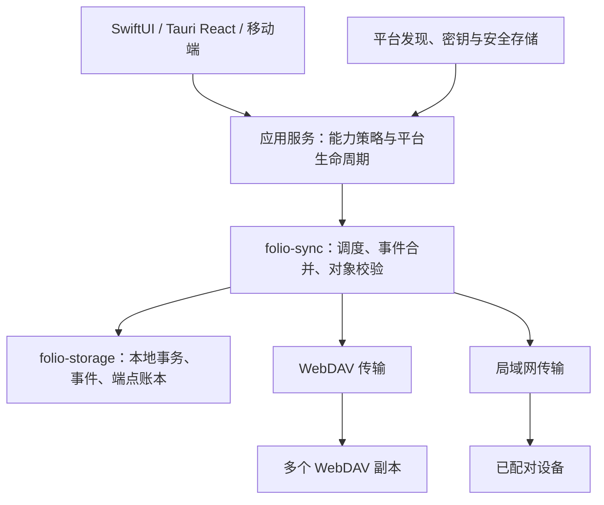

# Multi-Endpoint and LAN Sync Architecture

规划日期：2026-10-17。状态：**设计，待实施**。适用 macOS、Windows/Linux 和现有
移动端桥接；沿用客户端技术栈，不据此改变移动架构 go/no-go。赞助边界见
[官方 Release 计划](sponsor-release-plan.md)，执行阶段见 [路线图](../FOLIO_ROADMAP.md)。
来源与平台文件工作流以 [产品工作流架构](product-workflows.md) 为准；本轮补充不改变
Multi-WebDAV／LAN 的事件、端点账本、配对或 wire 迁移方向。

## 1. Verified Baseline

本轮仅检查源码与既有验证记录，没有重新执行设备或网络验收。

| 位置 | 当前事实 | 扩展时的约束 |
| --- | --- | --- |
| `folio-sync/src/lib.rs` | `SyncProfile` 单连接，`profile`／`disconnected_profile` 单值；`FORMAT_VERSION = 1` | 不可直接把设置改成数组后重复调用旧同步流程 |
| `folio-storage/src/schema.rs` | 当前 SQLite schema **v11**；v10/v11 已有文件与来源策略 | 后续使用新迁移，不修改已发布的迁移步骤；不预占版本号 |
| `folio-storage/src/sync.rs` | 单个 `published`、按设备的远端 cursor、全局资产记录 | 一个端点成功不能代表全部端点成功 |
| `save_profile`／`reset_sync_remote_state` | 更换账号／地址／目录会清理同步远端状态并轮换设备标识 | 多端点的新增、停用和编辑不得复用全局重置逻辑 |
| WebDAV v1 | `Folio/v1/events/<device>/…` 与 `objects/<fingerprint>`；发布仅写本设备事件 | 多副本需要安全转发其他设备事件，不能伪装成本设备新事件 |
| 事件与字体 | 事件有设备序列；部分变更有 `parents`，字体字节由内容指纹标识 | 沿用身份／修订和冲突规则，补齐跨传输的因果与去重契约 |
| [移动验证记录](../experiments/mobile/VALIDATION.md#cloud-sync-cycle-batch-6) | 前台自动同步、云端保留、重新下载、删除恢复、冲突及受控双库故障测试已有记录 | 独立服务商 HTTPS、123PAN 完整真机往返、真实桌面与移动双端仍有缺口 |

现有单 WebDAV 先按路线图 A 做可信度验收。以下设计不能登记为已实现，也不能把
受控服务测试写成独立服务商或全部移动设备通过。

## 2. Product Semantics

- 首期一个本地字体库对应一个 `SyncGroupId`，所有 WebDAV 端点及配对设备都是
  **该库的副本**。端点不是独立字体库，不把多个无关账户的现有内容自动合并。
- 多 WebDAV 支持多个账号、服务商与远端目录，分别保存启停、状态、优先级与凭据；
  首期仅完整同库双向副本。只读订阅、按收藏夹路由、独立工作区与团队权限不在首期。
- 局域网支持两台及以上设备直接双向同步，没有永久主节点，不需要公网、WebDAV、
  官方账号或云端中继参与传输。首次配对须用户确认；官方高级版的激活／续验另需
  访问授权服务器，有效租约及有限离线宽限内可断网直连。自行编译不依赖该服务。
- 云与局域网同步同一份事件和字体对象；优先从可达的已信任局域网设备取文件，
  再尝试 WebDAV。元数据仍追赶全部启用端点，不能因局域网完成就漏掉云端副本。
- 同步收藏、手动／智慧收藏夹、最近记录、托管字体与删除／恢复状态。SQLite 文件、
  绝对路径、库根、凭据、缓存、系统安装／启用状态不跨设备复制；下载及网络偏好
  留在设备。沿用上传排除规则，排除的文件字节不得经局域网或副本中转泄漏。
- 暂停／移除端点、取消配对、清理本地缓存与“全设备删除字体”是不同操作；
  前三者不自动产生字体删除事件。

上传排除是当前设备的传输策略，对该设备直接上传和中转同样生效；不追溯收回
其他副本已持有的字体，也不作为字体许可证或组内访问控制。启用排除后如需删除
既有云端副本，须走显式删除／恢复流程。

### 2.1 Reference and Managed Source Lifecycle

- 同步对象身份与来源所有权分别记录。Reference 保留原位置／权限，不因上传或
  Activate／Install 自动变成 Managed Copy；允许上传时固定读取快照，内容变化则
  重试或报告。传输暂存文件不构成用户的 Collect 决策。
- 远端只获得内容与可同步元数据，不携带本地路径、书签、content URI 或操作系统
  注册状态；接收端下载建立本机受管云副本，不复制发送端的 Reference 路径。
- 外部来源离线／移走／无权限、移除引用、仅清理受管缓存和 tombstone 是不同状态。
  前几者不生成全设备删除，也不清空逻辑用户状态；其他可用副本继续支持预览／导出。
- 全设备删除／恢复只作用于同步资产和 Folio 有权管理的副本，不删除外部原件。
  保留删除／排除关联，防止未移走的外部文件被下次扫描自动复活；显式恢复或重新
  加入才重新发布。具体本地来源展示与操作确认见工作流矩阵。
- 清理托管文件前检查 Activate／Install／Export／Provider 正在使用的引用与平台
  约束，安全暂停或拒绝清理；卸载只处理平台操作账本，不等于删除库或云端资料。
- 文件提供／导出按需调用同一原生下载与校验服务，不在 RN 中重建同步器。
  iOS File Provider 若采用，必须为无 RN runtime 的独立原生进程明确跨进程文件／
  数据库协调与凭据边界；主应用内的单实例运行锁不能作为进程间同步方案。

## 3. Shared Boundaries

- `folio-core` 保持平台无关；不引入网络、授权、SQLite 或系统发现 API。
- 官方高级版的云验证请求由应用服务处理，只更新本机能力状态；激活码、续验凭据
  和租约不进入同步事件或设备组信任。授权服务器不托管／中转字体，也不参与配对。
- `folio-storage` 保存设备本地结构与事务；本地 schema 与 wire schema 分别演进。
- 在现有 `folio-sync` 内分离事件编码／合并、协调器、WebDAV 与 LAN 传输模块；
  不提前拆出多个新 crate，不在 JS、Swift 或 Kotlin 重写合并算法。
- 传输边界表达 `describe_replica`、`list_event_ranges`、`fetch_events`、
  `publish_events`、`has_object`、`read_object_range`、`write_object`；
  WebDAV 用目录与文件实现，LAN 用受认证请求实现。传输返回持久接收结果，
  不直接改用户状态。
- 平台适配负责 Bonjour／NSD、权限、监听生命周期与安全存储。协调器通过薄的
  UniFFI／Tauri 接口启动、取消、读取状态，避免为高频分块往返 JS。
- WebDAV 密码按 `EndpointId` 存储；设备密钥按设备身份存储。SQLite 只保存
  `credential_ref`／`key_ref`。端点名称和来源识别继续复用现有规则。

## 4. Local Data Model

以下是拟定逻辑表与主键，不是本轮数据库迁移。

| 结构 | 主键／范围 | 内容与职责 |
| --- | --- | --- |
| `sync_groups` | `group_id` | wire 版本、组信任锚、迁移基线；首期仅一个活动组 |
| `sync_endpoints` | `endpoint_id` | 所属组、WebDAV 配置、`credential_ref`、启停、优先级、绑定的 `replica_id` 与远端代次 |
| `sync_devices` | `(group_id, device_id)` | 设备公钥、信任／撤销状态与设备 epoch；私钥不入表 |
| `sync_peers` | `(group_id, peer_device_id)` | 配对状态、最近可达地址、发现偏好；IP 不作为身份 |
| `sync_events` | `(group_id, event_id)`；唯一 `(group_id, device_id, epoch, sequence)` | 不可变规范事件字节、内容哈希、签名、父事件与应用状态 |
| `sync_received_ranges` | `(group_id, device_id, epoch)` | 已持久收到的连续水位与稀疏缺口；不代表所有对象已下载 |
| `sync_deliveries` | `(group_id, destination_id, event_id)` | 各 WebDAV／peer 的 pending、acknowledged、错误与重试时间 |
| `sync_replica_cursors` | `(group_id, destination_id, origin_device_id, epoch)` | 每个副本独立的扫描／确认进度；不得复用全局 cursor |
| `sync_object_locations` | `(group_id, fingerprint, destination_id)` | 该处对象的未知／已验证／缺失状态、长度、校验及最近检查时间 |
| `sync_transfers` | `(group_id, destination_id, fingerprint, direction)` | 断点、暂存文件、重试、取消；不同来源的分块分开验证 |
| `sync_conflicts` | `(group_id, entity_id, conflict_id)` | 合并后的冲突及解决事件；来源是附加信息，不重复产生冲突 |

`destination_id` 区分端点与设备类型。`replica_id` 是远端副本稳定标识，地址编辑
只更改路由；远端副本重建则改变代次并重新核对清单。发现同一副本被重复配置时
拒绝重复启用。远端凭据失效不轮换本地设备身份。

本地变更、事件追加与投递意图在同一事务提交；网络任务在事务之外运行。
远端事件验签／校验、去重、应用或登记待依赖、推进连续水位亦需原子提交。
下载失败只影响对象可用性，不能撤销已持久化的合法元数据。

## 5. Event and Conflict Contract

### 5.1 Wire v2

新增能力使用独立 **wire v2**，包含 `group_id`、`event_id`、来源设备／epoch／序列、
`parents`、变更体、规范字节哈希和设备签名。规范编码必须固定字段、数值与排序规则，
先写互操作样本再实现；不直接签名任意序列化器输出。设备序列在组内单调且不复用，
重装／恢复克隆库时生成新设备身份或 epoch，避免两台机器写同一序列。

wire v2 仅表示同步协议版本，不等于 SQLite 版本、安装包更新清单版本或 Folio 产品
主版本，也不要求等待路线图 F 的 Linux／格式扩展完成。

- 事件第一次进入任一传输队列即冻结。现有“替换未发布事件”逻辑不得在已通过
  其他端点或 LAN 送达后继续改写；后续编辑必须追加新事件。
- 转发保持来源、事件 ID、父关系、字节与签名。收到 A→LAN→B→WebDAV→A 的
  同一事件只应用一次，不因重复收到再次生成本地事件。
- 同一 ID 的不同字节隔离并报完整性错误，不接受后到覆盖。跨组事件拒绝导入。
- 连续水位只推进到无缺口的位置，乱序部分单独保留；未知父事件继续补拉，不能用
  最大序号跳过缺失项。恶意／超限记录隔离，不阻塞其他设备流。
- 元数据可以先于字体落地，显示真实占位和待下载状态；只有哈希验证后的完整文件
  才进入托管库并触发目录刷新。事件 ACK、文件完成与副本完整是三个独立状态。

### 5.2 Merge Rules

| 数据 | 首期合并规则 |
| --- | --- |
| 字体对象 | 按现有 `ContentFingerprint` 去重；`FontIdentityId`／`FontRevisionId` 语义不变；TTC/OTC 保留同一文件与成员索引 |
| 同身份不同字体修订 | 保留修订与已有冲突选项，不按到达顺序、来源优先级或系统时间覆盖 |
| 收藏与手动成员 | 每项操作包含已观察的父操作；并发添加／移除采用添加保留，看到该添加后再移除才生效 |
| 收藏夹名称、图标、颜色、智慧条件 | 因果后继覆盖已观察前值；并发不同值保留冲突，继续使用现有决策入口；解决事件覆盖全部已知分支 |
| 收藏夹／字体删除与并发编辑 | 保留删除墓碑和编辑分支，显示冲突；不静默删除或复活。显式恢复引用墓碑并生成新事件 |
| 最近记录 | 保留既有逐身份合并语义；时间仅参与最近排序，非法／明显未来值校验与偏差处置单列回归，不能用于消解其他领域冲突 |

表中规则是 v2 待验收契约；与 v1 不一致处必须通过迁移或版本隔离处理，不能宣称
原协议天然满足。跨语言桥接消费 Rust 的统一结果，不各自实现冲突胜负。

首期保留完整事件与墓碑，不做自动日志压缩或对象物理清除。局域网“已送达”不等于
完成持久备份。后续 GC 需检查所有活动副本／设备的确认水位及保留期；长期离线节点
只有明确退役后才可排除，重新加入需基线重建，避免旧事件复活已删除数据。

## 6. Multi-WebDAV Replication

### 6.1 Remote Layout

拟定远端目录：`<remote_directory>/Folio/v2/<group_id>/`，内含组信任描述、
`replica.json`、设备成员记录、`events/<origin_device>/<epoch>/<sequence>.json`、
`objects/<fingerprint>` 和可重建索引。与 v1 目录隔离，不覆盖 v1 文件。

- WebDAV 使用 HTTPS，保留现有重定向、跨站凭据隔离和路径校验；基础请求仍是
  `PROPFIND`／`MKCOL`／`GET`／`PUT`，不要求所有服务商提供相同锁语义。
  条件写入和 MOVE 作为经探测的能力，不作为全局一致性的保证。
  方法与响应语义依据 [RFC 4918](https://www.rfc-editor.org/rfc/rfc4918.html)。
- 远端组描述中的公钥不是自动可信。新设备纯 WebDAV 入组时可离线导出自己的
  公钥申请，由已有可信设备核对指纹并签发成员包，再导入新设备；成员包携带经
  核对的组信任锚。该流程不要求设备先在同一局域网，也不经官方授权服务器。
- 每个不可变文件独立验证。已有同名事件先比对哈希；PUT 成功还需确认完整内容后
  才登记送达。不使用一个可覆盖的总 manifest 作为唯一事实来源，避免并发丢更新。
- 文件先上传并校验，再发布引用它的本地资产事件。跨端转发已收到的事件时，如目标
  缺少关联文件，先从有副本的位置获取；取不到则保留事件待投递，显示副本未完整，
  不把对象缺失当成删除。纯元数据事件可独立发布。
- 传输加密不等于云端静态端到端加密。v2 首期对象和元数据仍可被 WebDAV 服务商
  读取；设备签名提供来源完整性，不能保证服务端未隐瞒／回滚记录。
  不宣称 E2EE；静态加密和跨设备密钥恢复另立设计，不捆绑首期。

### 6.2 Synchronization Cycle

1. 取得单库写入门并建立本轮变更快照，追加尚未记账的本地事件；释放事务后做网络请求。
2. 分别验证启用端点的组、副本身份及版本，按缺口范围拉取事件，校验后串行提交合并。
3. 计算每个端点自己的投递差集，包括从其他端点或 LAN 收到的事件；保持来源转发，
   不限于当前设备原创事件。
4. 按对象位置、下载偏好与上传排除规则补齐文件。对同一指纹合并下载需求，
   一个来源不可用时更换来源，不能把一个来源的断点不经校验用于另一个版本。
5. 各端点分别记录送达、待传文件、失败和下次重试；某端点故障时其他端点继续。
   中途新增本地变更进入下一轮，不无限延长当前轮次。

网络请求可限量并发，同一库的事务应用与同一对象最终落盘串行。自动重试采用有
上限的退避与抖动；认证失败暂停该端点，配额不足不循环重传，用户取消不立即重启。
首期不按收藏夹裁剪事件流，避免产生无法解释的序号缺口。

### 6.3 Endpoint Lifecycle

- 新端点先探测空库／同组／其他组。空库经确认初始化；同组做差集追赶；其他组
  拒绝自动合并，要求另选目录。初始化同一目录的并发组创建需检测并报告冲突。
- 编辑地址、账号或目录后重新核对副本身份；不能继承另一副本的 cursor，
  也不清理原端点账本或其他端点数据。验证通过才提交路由变更。
- 停用／移除端点只停止该端点任务并处理其凭据，不删除远端文件或清空本地库。
- 一个端点目录被外部删空时进入修复确认，不能把空目录解释为全库删除；
  重新播种保留原事件 ID。内容缺失与签名删除事件严格区分。
- 总状态区分“全部副本完成”“部分副本未完成”和“存在冲突”，各端点显示最近
  成功与待传数量。不以一次成功覆盖另一个服务商的错误或宣称强一致。

## 7. LAN Discovery and Trust

### 7.1 Discovery

- 使用 mDNS／DNS-SD，服务类型拟定 `_folio-sync._tcp`；发现和传输生命周期由
  原生适配负责。DNS-SD 服务记录设计依据
  [RFC 6763](https://www.rfc-editor.org/rfc/rfc6763.html)，Android 使用
  [NSD](https://developer.android.com/develop/connectivity/wifi/use-nsd)。
- 广播仅含临时实例标识、协议能力和端口，不带账号、库名、字体清单、凭证或完整
  稳定设备标识；已配对身份在认证连接内确认，不能把发现结果当成可信设备。
- 提供手动地址／二维码入口，处理组播被屏蔽、访客 Wi-Fi 隔离、IPv4/IPv6、多网卡、
  休眠和 IP 变化。拒绝权限时给真实诊断，不循环弹窗或自动切到公网中继。
- 首期用户开启时才监听局域网接口，禁止自动路由端口映射，不提供互联网穿透。
  Apple 本地网络权限与声明按
  [TN3179](https://developer.apple.com/documentation/technotes/tn3179-understanding-local-network-privacy)
  验收；Windows/Linux 防火墙提示与多接口行为单独实测。

### 7.2 Pairing and Membership

1. 每台设备生成独立设备密钥，私钥留在平台安全存储；首次创建组的设备产生组
   信任锚。组管理密钥不等于官方赞助签发密钥，也不经 WebDAV 明文同步。
2. 用户在已信任设备开启有时限的配对窗口；二维码携带端点、证书／设备公钥指纹、
   一次性高熵邀请和组邀请签名。手动连接后双方核对由握手 transcript 导出的短码，
   两端确认才建立信任；短码用于核对，不充当 TLS 密钥。
3. 接受后保存公钥绑定并签发组成员记录，后续使用 TLS 1.3 双向设备认证／固定公钥
   验证。首次只允许配对握手，配对前不开放字体清单、事件或文件请求。
4. 已授权配对的设备可邀请新设备，签发链必须可追溯到组信任锚；首期所有成员均为
   用户自己的完整读写设备。凭 IP、同一 Wi-Fi 或持有 WebDAV 密码不能获得成员身份。
5. 取消配对立即停止本机与该 peer 的传输；从同步组移除还需签名撤销成员记录，
   经所有传输传播。首期撤销该成员及其邀请后代，重新加入需新邀请；以已确认的
   设备 epoch／序列界定可保留历史，拒绝撤销后新的写入。

TLS 方案使用成熟实现，禁用写请求的 0-RTT，配对增加超时、尝试限频和单次邀请
消耗规则；依据 [TLS 1.3](https://www.rfc-editor.org/rfc/rfc8446.html)。密钥轮换、
丢失和备份恢复必须有样本：丢失设备私钥创建新身份；失去全部信任设备及恢复材料
则从可读资料创建新组，不静默相信远端自报公钥。

成员撤销在离线设备重新连接并收到最新成员记录后生效，不能承诺立即撤销离线节点，
也无法收回已下载文件。若被移除设备掌握 WebDAV 凭据，还需在服务商更换凭据并在
保留设备更新；这与客户端签名验证分开处理。

## 8. LAN Transfer and Scheduling

认证连接使用 HTTPS 请求交换组／设备版本、成员记录、事件连续水位与缺口、事件
批次和对象范围。接口包含 `hello`、`inventory`、`events`、`objects` 与 `ack`；
协议版本、批次字节上限、并发、对象尺寸上限和分块策略在 G 阶段用样本固定。

- 请求对象只接受已验证的组内指纹，不能请求任意绝对路径。每次请求检查成员状态，
  严格限制路径、事件深度、JSON／响应长度、速率与临时存储空间。
- 接收方在持久事务提交后 ACK，发送方只更新该 peer 的投递账本。连接断开重试
  同一事件，不重新生成事件 ID；重复 ACK 安全。
- 大文件写设备私有暂存区，以范围／分块校验续传，最终使用现有内容指纹验证全文件，
  原子落盘后解析并发布可用状态。取消、断电、空间不足保留可安全恢复的断点。
- 已信任 LAN 来源优先，失败后回退可用 WebDAV；不向未配对设备探测字体存在性。
  LAN 与云同时完成同一对象时只提交一次，其余任务取消并保留正确的副本状态。
- 桌面首期只在应用运行且用户开启时监听，不安装系统常驻服务；移动端首期只保证
  前台及系统允许的短暂收尾，切后台安全暂停并在前台追赶，不承诺全天在线。
- iOS 后台策略按
  [Apple Background Tasks](https://developer.apple.com/documentation/backgroundtasks/choosing-background-strategies-for-your-app)
  另验；Android 长任务如需系统调度／前台服务，按
  [Android 长任务约束](https://developer.android.com/develop/background-work/background-tasks/persistent/how-to/long-running)
  单独设计通知、权限与取消。首期不为绕过限制增加后台常驻机制。

示例：手机在局域网把事件 E 和文件 F 交给电脑；电脑离线于服务商 X 时仍可把原样 E/F
送到 Y，稍后补齐 X。手机从 Y 再收到 E 只增加该来源的送达知识，不再改收藏或新增
冲突；Y 缺少 F 时显示文件待补，不把手机已有文件删掉。

## 9. Migration and Compatibility

1. G 阶段先增补端点局部账本，导入旧单 profile 为一个端点，迁移平台凭据引用；
   保存旧凭据直至新读取验证成功，迁移失败可重试，不清空用户库或轮换设备身份。
2. v1 模式继续运行现有单 WebDAV；仅本地表扩展不能使 v1 自动成为多端点协议。
   `published = true` 只可作为旧端点的历史线索，新端点仍须核对远端库存，
   不把该值复制为所有端点的已送达。
3. 用户显式迁移组到 v2 前，备份本地状态、核对字体副本并停止全部 v1 写入设备。
   建立签名的 v2 基线快照，记录 v1 水位／哈希和身份映射；旧事件未带设备签名，
   只能作为经用户确认的迁移历史，不能伪造旧设备的 v2 签名。
4. 迁移保留字体身份、修订、收藏夹 ID、成员、收藏、最近记录、墓碑和未解决冲突；
   以固定样本验证与旧库相同的可见状态。新的 v2 设备身份与旧来源映射分开记录。
5. 所有参与设备升级／重新配对后再启用多端点或 LAN。迁移断电可从检查点继续，
   提交成功前仍保持 v1；成功后禁止向 v1 回写，保留原远端目录供恢复。
6. v1 客户端不会自行识别 v2，且无法强制已离线旧客户端停写。迁移前明确列出设备，
   用户确认停用；旧客户端晚到写入只留在 v1，显式核对导入差异，不能自动双写桥接。
   迁移后回退旧应用须使用独立恢复副本，不打开较新 SQLite schema。
7. wire 版本不受支持时停止该端点写入并提示升级，其他兼容端点仍可运行。
   赞助能力与渠道不参与协议协商，免费单端点也能读取其支持的 v2 数据。

## 10. Acceptance Matrix

| 场景 | 必须验证的结果 |
| --- | --- |
| 两台设备、两个不同服务商 | 分别新增字体和用户状态，最终事件与领域状态收敛；不能只比较记录数量 |
| 三台设备、两 WebDAV 加 LAN 环路 | 乱序／重复／重复 ACK 不产生新事件或重复冲突；来源签名保持一致 |
| 端点隔离 | X 认证失败／满额／删空时 Y 与 LAN 正常；恢复 X 只补差集，不重置设备或误删 |
| 连续水位与崩溃 | 缺第 N 项而收到 N+1，重启仍补 N；事务／ACK 任一点断电后重放安全 |
| 并发编辑与删除 | 收藏、成员、名称、智慧条件、字体修订、删除／恢复在不同到达顺序下结果相同，冲突可逆 |
| 文件完整性 | TTC 非零成员、变量字体、大文件、坏块、假长度、空间不足与来源切换均不暴露坏预览 |
| 隐私与策略 | 上传排除在两条传输及中转中生效；凭据不入库／日志／事件；跨组和路径穿越请求拒绝 |
| 来源与操作分离 | Reference／Managed 并存、外部盘离线／权限撤销、移除引用、全设备删除／恢复、清理正被启用／安装／Export／Provider 使用的副本不混淆；原件不误删、扫描不自动复活墓碑 |
| 文件提供与扩展 | DocumentsProvider／被采用的 iOS File Provider 无 RN runtime 时可读真实校验对象或明确失败，取消与进程重启不破坏端点账本 |
| 产品 v2 格式 | WOFF／WOFF2 支持交付后验证原始字节／指纹与身份、单端点／多端点／LAN；格式支持不自动触发系统安装 |
| 配对与撤销 | 伪造发现、短码不符、邀请重放、错误证书、已撤销成员及其后代、密钥丢失均有明确结果 |
| 纯云端入组 | 不在同一 LAN 的新设备经申请／成员包加入；伪造远端组公钥不被自动信任 |
| 网络与生命周期 | 组播不可用、手动地址、IPv6、多网卡、访客隔离、拒绝权限、休眠／前后台、用户取消可恢复 |
| 迁移与兼容 | 现有 v11、v6 缺表历史样本、迁移中断、旧设备迟到、新旧 wire、跨渠道切换保持用户状态 |
| 权益边界 | 单 WebDAV 免费含多设备；社区优化构建全开；官方解锁、暂停和恢复模式与同一协议互通 |

每项报告记录应用提交、平台／系统／设备、真实服务商或受控服务、样本、故障注入、
最终状态摘要及未测项。先过 Rust/Storage/FFI 与受控服务矩阵，再做 macOS↔Windows、
桌面↔Android、桌面↔iOS 和至少三设备混合实测；Linux 跟随原平台阶段。
没有相应设备的组合维持 PARTIAL，不用构建通过替代网络与设备验收。
